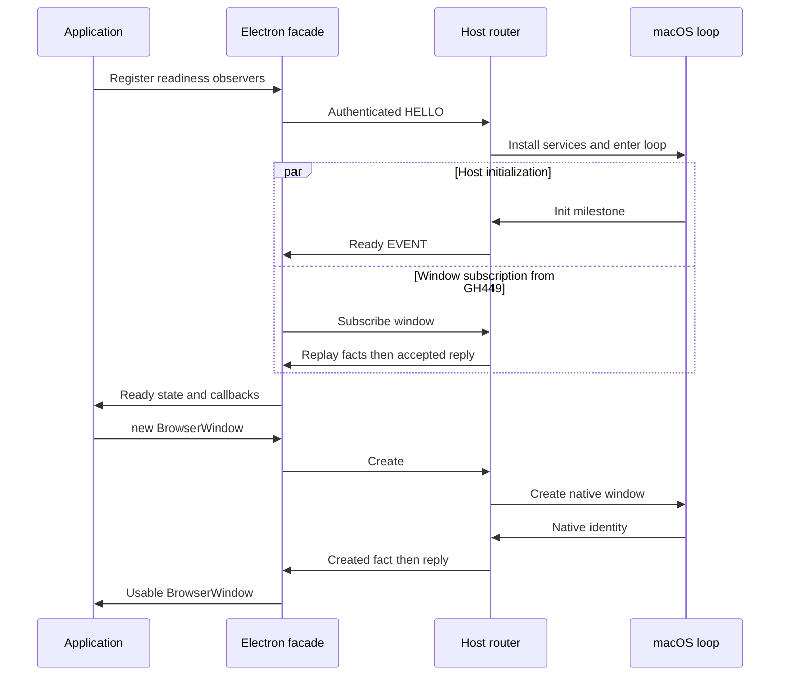

# Spec: facade-boot Ready — host initialized and window module available before any app window (F01-T2)
Status: approved
Linear: GH-446 (#517) · Owner: @0monish · Updated: 2026-10-23

Revision basis: `gyldlab/keld` main `3503a8aa383427dcf50ccbf6653c4298e7fb8aad`.
The 2026-10-23 owner-delegated decision and exact-content approval are recorded in
§10 and the [approval record](https://github.com/gyldlab/keld/pull/657#issuecomment-6371083658).
Approved technical head: `a04e1ed889733a64cc33c1b64535e02b4afb0902`.
This revision carries approval metadata over independently reviewed design and
source evidence; it is not a receipt that the proposed macOS behavior has run.

## 1. Goal & non-goals

In an Electron app, readiness is independent of a window, and application code
requests its windows after initialization. `ready` listeners and `whenReady()`
continuations can both create them; this spec does not impose an order between those
callbacks. In Keld, the
host emits lifecycle `Ready` only after it has created its own window and finished
that window's first navigation:

- `coordinate_window_events` maps `AppWindowEvent::NavigationReady` to
  `PrimaryRouterHandle::signal_ready` (`crates/keld-core/src/app_session.rs`).
- That event fires only for the host-created initial window
  (`crates/keld-wv/src/wkwebview/mod.rs`, `NavigationReady` emission).

So an `@keld/electron` main that calls `new BrowserWindow()` inside `whenReady` would
get a second window next to a host window it never asked for. This spec decides who
creates window #1 and what `Ready` means for each generation.

The observable outcome is a new boot kind. When the compiled descriptor declares that
the app creates every window, the host on macOS:

1. authenticates the role's `HELLO`;
2. enters its UI loop with no window;
3. writes `Ready` once, on the loop's `Init` turn.

In the initial generation, the app then sees `ready`/`whenReady` with zero application
windows. From #449, the facade also completes window subscription and replay before
publishing readiness. The host refuses non-subscription window calls before its
`Ready` transition. Recovered generations may already have surviving windows (D7).
Renderer-declared boots preserve their existing contract.

Non-goals:

- The window `Create` call and the `BrowserWindow` constructor (F02-T2 #449, gh531).
- `Create` adoption for recovered generations. The gh531 registry owns it (gh531 D6
  scope, amended by #657), and it lands with #449 (gh531 T1).
- Two-phase quit (F01-T3).
- Launch-time `open-url`/`open-file` delivery (#524, F01-T8).
- Windows and Linux emission points. Those hosts refuse the new boot kind (D9).
- `keld migrate` writing the new config field, and `compat: { electron: true }` (architecture 04 §2 sketch).
- The cold-start delta. It is measured under X05-T1's registered metric and is not
  an acceptance criterion here.

## 2. Spec refs

Governing:

- `docs/specs/kel96-no-flag-host-boot.md`: §4.1 (D3, D11), §4.2, §4.4, §4.5, §7, and AC1, AC8, AC11, AC16.
- `docs/specs/kel139-macos-product-spine.md`: AC3, AC5, and "Recovery".
- `docs/specs/kel142-macos-renderer-bridge-api.md`: AC4 (`whenReady` waits for real host `Ready`).
- `docs/specs/kel75-principalized-bun-child-roles.md`: role owners table, and "`LinkBound(g)` and `Ready(g)` are deliberately separate".
- `docs/specs/gh531-window-registry-close-state-machine.md`: criteria 13–15, criterion 30, §4.c, §4.i D6, the Boundaries adoption line, and §6.
- `docs/specs/gh527-worker-owned-blocking-call-transport.md`: §4.6–§4.7.
- `docs/specs/gh532-first-proof-evidence-rules.md`: rules 4–6.
- `docs/specs/gh566-corpus-manifest-owner.md`: target admission.
- `docs/engineering/keld-error-codes.md`: `KELD-CORE-034`, `KELD-CORE-035`, `KELD-CORE-037`.
- Architecture 01 §5 (cold start). Architecture 02, no-flag primary paragraph. Architecture 05 §3 (window ownership). Architecture 06 §1 (macOS/Windows no-flag primary).
- PANEL-P2 #419 settles close and quit only. Nothing in it concerns `Ready`.

Deviations, applied by the implementing change (T1) with the exact text in §4.10:

- KEL-96 gains decision row D12 and amended AC1, AC8 and AC11. It also gets amended §4.4 steps 2 and 7, a §4.5 note, and amended approval metadata and §7.
- KEL-139 "Recovery" and AC3 gain one scoping sentence each.
- Architecture 02 and architecture 06 §1 change one sentence each.
- `keld-error-codes.md` amends 034 and 035 and registers 044.

This spec PR also amends gh531 in place. Each change is marked "amended by #657":

- **§4.i D6:** the 2026-10-08 scope paragraph.
- **Criterion 14:** its "Before Ready" rule (D4 here).
- **§4.c and §4 Migration:** the owner and removal condition of the legacy teardown arm.
- **§6 T1/T2:** the D6 re-slice.
- **Criterion 20 and the Boundaries adoption line:** the 2026-10-23 revision makes
  accepted subscription and complete replay a facade-readiness prerequisite, and
  records the new, narrowly scoped KEL-139 recovery amendment (§10).
- **Criterion 46:** independent host/facade identity controls and legitimate multiple
  creates distinguish adoption from an accidental one-window limit.

The exact-content approval in §10 covers these amendments together. The
historical approvals of KEL-96, KEL-139 and gh531 do not by themselves approve the
new semantics. This PR changes only this spec and gh531; T1 applies §4.10 to their
owning documents with the production change.

## 3. Acceptance criteria (binary, each becomes a test)

The names below are proposed.

1. **Schema 2 parses.** Given `{"schema":2,"name":"A","entry":"src/main.ts","permissions":{…}}`, when the host parses it, then the selection's initial window is `InitialWindow::None`. *NC:* a schema-2 document with a `renderer` key (even `null`), or with any unknown field (including `initial_window`), is rejected with `KELD-CORE-035`.
2. **Schema 1 is unchanged.** Given every existing schema-1 parse and staging test, including the approved optional `auth` configuration, when it runs, then it passes unchanged. The one exception: in `duplicate_unknown_version_name_and_permissions_fields_fail_closed` (`app_session/tests/boot_schema_and_preflight.rs`), the unsupported-version probe moves from `schema:2` to `schema:3`. *NC:* making `renderer` optional in the schema-1 struct makes a schema-1 document without `renderer` parse, and the new `schema_one_still_requires_renderer` fails. Schema 2 does not inherit the schema-1 `auth` field implicitly.
3. **Compiler declaration.** Given `keld.config.ts` with `initialWindow: "none"`, when `keld dev` stages, then the stage holds a schema-2 descriptor and no renderer file.
   - The same config with `renderer:` also set fails with `KELD-CLI-047` (phase `project config`), naming both fields and the fix.
   - Without `initialWindow`, the descriptor bytes equal today's schema-1 output.
   - *NC:* defaulting `renderer` to `index.html` when `initialWindow` is `"none"` stages a renderer and fails the test.
4. **Ready before any window, generation 1 (macOS, real host).** Given a schema-2 boot whose `@keld/electron` main prints `READY` inside `app.whenReady()`, when the test reads `READY`, then:
   - the role has read exactly one lifecycle `Ready`, and it was the first application-lifecycle **EVENT** after its `HELLO` reply (a correlated control `REPLY`, including `Subscribed`, may precede it);
   - `app.isReady()` is true;
   - a successful, process-wide native application-window census for the host PID is 0, including hidden, untitled and differently titled application windows.

   The census stays 0 until this fixture's Quit. Its process-wide observation defines application windows separately from system auxiliary windows, reports observation failure as unavailable (never zero), and uses the PID only to select the observed process, never as authority. The existing title-filtered `NativeWindowObserver` remains the positive presentation oracle; its empty result cannot satisfy this criterion. Positive controls create a hidden, untitled and differently titled native application window and must each make the zero assertion fail. *Independent NC:* restoring the host-created initial window, with `Ready` on its `NavigationReady`, makes the census 1 at `READY`. A claim that no application window was ever allocated before Ready additionally requires a native allocation-history receipt; a create-then-destroy control must defeat that stronger claim. A snapshot alone proves absence at its observation boundary.
5. **Host initialized, not just authenticated.** Given a schema-2 router with an authenticated, installed generation, when no `HostInitialized` event has been delivered, then the role's echo-fence call gets its reply and no application-lifecycle EVENT has been written. Correlated control replies remain legal. After `HostInitialized`, exactly one `Ready` is written. *NC:* writing `Ready` at generation install (on `HELLO` acceptance) makes the role read `Ready` before the fence reply.
6. **Exactly once, one trigger per boot kind.** In both directions, a trigger that belongs to the other boot kind writes no `Ready` and ends the session with `KELD-CORE-044`:
   - a schema-2 coordinator that receives `NavigationReady`;
   - a schema-1 coordinator that receives `HostInitialized`.

   A second trigger event also ends the session with `KELD-CORE-044`. *NC:* mapping both events to `signal_ready` writes a second `Ready` once recovery is armed.
7. **Only the `Init` turn triggers, and the UI loop serves commands at Ready.**
   - **Unit (keld-wv).** The loop's milestone handler is a pure function of the tao event and its state. Given the sequence `Event::Opened`, then `Event::NewEvents(StartCause::Init)`, then `Event::NewEvents(StartCause::WaitCancelled)`, it emits exactly one `HostInitialized`, at `Init`. Given an `Init` already seen and a past deadline, it does not exit. *NC:* emitting on the first closure call emits at `Opened`. *NC:* keeping the navigation deadline after `Init` exits a healthy windowless session.
   - **Integration (macOS).** Given AC4's boot, when the main calls `app.quit()` in the `whenReady` continuation, then the KEL-96 §4.5 order holds: correlated reply, revoke and close, terminate and reap, UI exit, exit status 0, zero Keld descendants.
8. **Recovered generation, host side (macOS).** Given AC4's boot after `READY`, when only the Bun role is killed, then:
   - the successor authenticates and reads exactly one `Ready`;
   - the census stays 0 throughout, because the host creates no window in any generation.

   *NC:* removing the `window_ready` replay in successor install leaves the successor's `whenReady` pending past its echo fence.
9. **Recovered generation, compat side.** The `electron-app-v1` cell `app.ready.recovered-generation` is recorded `unknown` on macOS. It is uncited (gh532 rule 6), because Electron has no corresponding supervised main-process recovery contract to cite. Its mapped today-test asserts that a fresh role process observes exactly one replayed `Ready`. *NC:* names #449's keld-core test of gh531 criterion 46: deleting the registry's adoption arm makes a successor `Create` allocate a new native window while an eligible survivor exists. This is an adoption invariant (D7), not a cap on legitimate application-created windows.
10. **Renderer boots and the KEL-237 gate.** On the final diff, these pass unchanged:
    - `successor_reader_waits_for_retired_fs_drain_before_ready_and_call` (the G2 Ready replay, under `app_session/tests/`);
    - `recovered_generation_orders_window_events_once_across_installation`;
    - `retired_generation_eof_cannot_fail_or_replace_the_successor`;
    - `failed_initial_ready_write_denies_recovery_before_successor`;
    - `pre_ready_bun_crash_is_startup_failure_not_a_recovered_window`;
    - the macOS, Linux and Windows no-flag lifecycle cycles;
    - `lifecycle_corpus_rust_oracles_execute`, which runs the cell `app.when-ready.host-ready-gate` → `when_ready_does_not_resolve_before_host_ready_event`.

    *NCs (from the issue):* removing the schema-1 `Ready` replay fails the G2 replay test, and replacing `whenReady` with `Promise.resolve()` fails the KEL-237 cell.
11. **Other platforms fail closed.** Given a schema-2 descriptor on Linux or Windows, when `keld-host` starts with no flag, then it fails with `KELD-CORE-034`. The detail says schema 2 runs on macOS only, and the fix is to remove `initialWindow` from `keld.config.ts`. This happens before any endpoint, child or window exists, with one attempt. *NC:* removing the platform check sends the boot into the renderer path, which has no renderer, and the test fails at its no-resource assertion.
12. **Existing cells pass unchanged (restates the issue's AC1).** `app.ready.emitted-once`, `app.when-ready.is-ready-agreement` and the KEL-237 cell `app.when-ready.host-ready-gate` pass unchanged on the final diff. Initial facade-window absence is proven by AC4's dedicated native observation and kept by AC16; it is not a new corpus cell. The first two cells are `electron-app-v1`'s (#656), and #656 already records both as `pass`; this proposal neither flips those records nor treats them as proof that production has no host-created window.
13. **Docs.** The §4.10 text lands in the same change as the emission point, and KEL-96's header digest equals the §4.1 recomputation (§7).
14. **A failed window-module install writes no Ready.** Given a schema-2 coordinator, when the engine drops its event sender before `HostInitialized` (an install step failed), then:
    - the coordinator returns `KELD-CORE-037`;
    - the role's echo fence shows no application-lifecycle EVENT;
    - recovery is denied, so a concurrent successor request is rejected.

    *NC:* signalling `Ready` when the coordinator starts, before the install result, writes `Ready`.
15. **Bounded wait for the `Init` turn.** Given a schema-2 coordinator whose deadline has passed and which has received no `HostInitialized`, when it waits, then:
    - it constructs `KELD-CORE-037`, with the detail "the UI loop did not deliver its first turn within 15 s", and passes the error by borrow to the terminal function after bounded cleanup;
    - it writes no `Ready`;
    - it denies recovery and invokes the existing bounded, UI-independent authority/child cleanup owners;
    - it calls the binary-owned terminal function exactly once, preserving main-thread custody and leaving the dev stage intact when release is unproved (AC20).

    *NC:* an unbounded `recv()` never reaches the terminal callback. The test uses a bounded observation of that callback receiving the typed error, not an assertion that the diverging path returns normally. AC20 exercises actual termination in a child: one `TERMINAL_ENTERED` record, failure exit, and no `COORDINATOR_RETURNED` marker. A mutation that returns `Err(037)` instead of invoking the terminal function fails that oracle.
16. **Window calls before Ready (an edge F02-T2 must satisfy).** `Subscribe` to `window` is accepted before Ready (gh531 "Subscription before the table"). Given a facade boot whose first `Ready` write has not happened, when a role whose link is subscribed to `window` sends `Create` or any other window call, then the reply is `KELD-CORE-040` and no native window is created. An unsubscribed link gets `KELD-CORE-045` instead, because that check runs first. *NC:* marking the registry ready when it is constructed serves that `Create`. This spec decides the rule (D4). Its test lands with the first window call, in F02-T2 (gh531 criterion 14 "Before Ready", amended by #657).
17. **Entry-evaluation ordering is qualified, not inferred.** Run separate CJS and native-ESM synchronous-entry fixtures, plus a target-derived fixture whose imported dependency invokes `whenReady()` during evaluation before the entry registers its own `ready` listener. For each qualified graph, record dependency start/end, entry start/end, Ready delivery and both public callbacks; neither callback runs before synchronous graph evaluation completes, and the listener sees one event. Coalesce HELLO acceptance and Ready in one transport delivery and separately delay listener attachment. *NCs:* dispatch Ready before listener installation; replace the host-ready gate with an already-resolved promise; or omit a dependency from the target-derived fixture. Awaited ESM setup is a separate Electron behavior, not implied by a synchronous test (D5, §4.12). Owner: #445/#446 for lifecycle scheduling; any loader change needs a separately reviewed boundary and must preserve native `@keld/api` callers that await filesystem/auth readiness.
18. **One usable public facade-ready state (#449).** With raw host Ready received but the correlated window `Subscribe` acceptance held, `app.isReady()` remains false, `whenReady()` remains pending and `ready` has not fired. After every replayed `Created` fact is applied and the accepted `Subscribed` reply is processed, all three agree, and a constructor in either callback succeeds. Repeat with zero survivors, with survivors, and on successor install where Ready precedes reader startup. A refused subscription fails closed. *NCs:* resolve on raw Ready, mark ready when Subscribe is merely sent, or move the reply ahead of replay. Keep this facade composition out of the shared native API readiness policy.
19. **Adoption identity is independent (#449).** Arrange a live host window reference and successor role generation that cannot equal the facade's first local allocation counter. Subscribe/replay, construct, and assert the constructor returns the existing mirror object, host reference and native identity, with zero new native allocations. Retain two survivors, consume only one, and verify both native identities survive. Separately create two legitimate new windows after eligibility is exhausted. *NCs:* map a facade counter to a host id, drop an unclaimed survivor, disable adoption, or enforce a global one-window cap. These controls must each fail their own assertion.
20. **Failure custody survives the new boot mode (#446).** The ordinary host runner still returns `Result<(), HostRunFailure>`; unresolved AppKit/presentation/profile owners remain on the main thread, are reported by borrow, and live through the binary's fatal exit. Exercise the stalled-Init terminal path in a child process: the typed failure occurs once, no Ready/recovery is admitted, and an unproved dev stage is not removed. Verify the ordinary retained-custody return path unchanged. *NCs:* flatten the failure to `HostAppError`, move or drop a retained owner, remove the stage before custody is proved, or treat process exit as a physical-drain receipt. The terminal callback may borrow a plain worker error; it receives no retained owner.

## 4. Design

### 4.0 First-principles and reuse decision

This is architecture under root AGENTS.md: it changes who owns the creation of
window #1, which sets crash ownership of the first window. It also changes when
recovery is armed for the new boot kind. The atoms separate observed source facts,
inferences and proposed tests. An unrun falsifier is a required check, not evidence
that the proposed runtime behavior has passed.

| # | Atom | Owner | Boundary, input → output | Failure mode | Observable | Evidence |
|---|---|---|---|---|---|---|
| A1 | Who declares the boot kind | the boot compiler (`keld-cli boot.rs`) and parser (`app_session/boot_contract.rs`) | `keld.config.ts` → `keld.boot.json` → `ParsedBoot` | the kind is inferred from absence, or the host guesses | AC1–AC3 | FACT: schema 1 is closed, requires `renderer`, and admits the existing optional `auth`; KEL-96 §4.2 requires a version decision. Schema 2 is absent on the pinned main |
| A2 | Host initialized | `keld-core` startup state machine and the keld-wv macOS loop | `HELLO` + installed generation + `Init` turn → `Ready` trigger | `Ready` before the host can serve, before a startup failure, or on a pre-`Init` event | AC5, AC7 | FACT (tao 0.35.3): `NewEvents(StartCause::Init)` is issued from `applicationDidFinishLaunching:` (`platform_impl/macos/app_state.rs`); `open_urls` delivers `Event::Opened` through the same callback with no ready check; macOS `run_app` awaits `HELLO` before `WkWebViewEngine::new` |
| A3 | Window module available, and no window call before Ready | the gh531 registry (F02-T2); today the UI wake bridge | installed window-call servers → app `Create` | `Create` refused after `Ready`, or served before it | AC14, AC16, AC18, gh531 criterion 14 | FACT: `spawn_app_wake_bridge` runs before `run_return`; the g1 reader starts at install, before the loop; successor install replays `Ready` before it starts the reader. Therefore raw host Ready alone cannot prove successor Subscribe completed |
| A4 | One `Ready` per generation and a usable facade-ready state | primary router; facade composes the existing link and subscription | trigger → Ready EVENT → accepted subscription/replay → public readiness | duplicate or lost Ready; constructor sees an untransferred registry | AC4–AC6, AC8, AC17–AC18 | FACT: `signal_ready` writes again once recovery is armed; `ensureLink` is lazy; WorkerLink drops an EVENT with no listener. INFERENCE: later-task dispatch avoids losing coalesced HELLO/Ready. AC17's coalesced and delayed-listener tests must prove that scheduling; an ordinary AC4 run alone does not |
| A5 | Failure and timeout | KEL-96 §4.4 rules; keld-core coordinator | pre-`Ready` failure → typed startup failure; post-`Ready` → runtime rules | hung boot, or misclassified failure | AC7, AC11, AC14, AC15 | FACT (tao 0.35.3): the waker starts only in `launched` (`app_state.rs:300-301`), and `wakeup` returns while `!HANDLER.is_ready()` (`:319-325`). So proxy commands (`Quit`, `Fatal`) and `WaitUntil` deadlines are inert before `Init` |
| A6 | Renderer boots unchanged | KEL-96, KEL-139 | schema 1 → today's path | a changed descriptor, trigger or replay | AC2, AC10 | FACT: named tests above; gh531 criterion 15 |
| A7 | Recovered schema-2 generation | host: this spec; eligible Create adoption: the gh531 registry (#449) | g1 loss → g2 `HELLO` → raw Ready replay → Subscribe/Created replay/accepted reply → public readiness → Create adopts | extra allocation for an eligible survivor; lost native identity | AC8, AC9, AC19 | FACT: replay comes from the `window_ready` flag at successor install; gh531 D6 Option B retains every survivor, independent of adoption eligibility. The new document-state qualification is in §4.10 |
| A8 | Wire | keld-ipc | `LifecycleEvent::Ready` `0x00` | a new variant | none | FACT: doc "The host is ready for the app process to create windows / run." (`keld-ipc/src/lifecycle.rs:26`) |
| A9 | Platforms | keld-core parser per OS | schema 2 on Windows/Linux → refusal | hollow backend method; silent fallback | AC11 | FACT: KEL-96 §4.4 forbids a hollow `WebEngine` method; `KELD-CORE-034` is registered as "No-flag application boot is unavailable on this platform" |
| A10 | Main-entry evaluation | Bun entry loader and facade lifecycle adapter | dependency/entry evaluation → later lifecycle delivery | early Ready while awaited setup or an imported module is still evaluating | AC17, §4.12 | FACT: Electron v44.4.5 waits for its ESM entry load; Keld launches Bun directly and has no equivalent app-code-loaded signal. The pinned draw.io entry is native ESM. General awaited-entry equivalence is unproved |
| A11 | Native failure custody | keld-core main owner and keld-host fatal tail | unresolved AppKit/profile owner → borrowed report → failed process exit | flattening/dropping an owner or deleting its live stage | AC20 | FACT: current `HostRunFailure` retains a `!Send` macOS payload; `main` reports by borrow and skips dev-stage cleanup while custody is retained |

Independence and the coupling they expose:

- **A2 ↔ A5 coupling.** Moving the trigger earlier also moves the recovery-arm point,
  because recovery is armed on the first successful `Ready` write (KEL-96 §4.4). This
  edge is explicit: D3 and D4 put every startup-fallible step before the trigger, so
  the arm point never precedes a startup failure.
- **A3 ↔ F02-T2.** This is an edge, not shared state. This spec fixes where the
  registry install sits and when its not-ready state ends. F02-T2 builds the registry
  and its test (AC16).
- **A7 ↔ gh531 D6 and #449.** These are explicit cross-spec edges. D6 owns host crash
  ownership of windows for every boot kind. The registry's `Create` adoption, which
  lands with #449, owns the no-second-window rule, keyed on registry state.

Reuse:

- **Wire.** Kept: lifecycle channel 3 and its replay rule. No new message.
- **Router.** Kept: `PrimaryRouterHandle::signal_ready` and its arm protocol. Only
  the event that calls it changes per boot kind.
- **Replay.** Kept: the `window_ready` replay at successor install. It already means
  "the initial `Ready` was written".
- **macOS UI loop.** One private owner, parameterized by its startup milestone. No
  copied closure.
- **Deadline.** One constant, `INITIAL_NAVIGATION_DEADLINE`, renamed
  `INITIAL_MILESTONE_DEADLINE` in T1 with the same value.
- **Window observation.** Keep `NativeWindowObserver` for its positive, title-scoped
  presentation/identity checks. Add the independent process-wide application-window
  absence oracle in AC4; do not reinterpret an empty title match as zero windows.
- **Error codes.** Reused: `KELD-CORE-034` (platform), `035` (descriptor), `037`
  (session startup), `040` (registry not ready, gh531) and `KELD-CLI-047` (staging).
  One new code, `KELD-CORE-044`, takes the next number after gh531's reserved
  038–043, so F02-T2 cannot collide with it.

No rewrite. Compatibility fallback: `not required`. Schema 1 stays valid and is still
emitted for renderer boots, so no published descriptor changes meaning.

### 4.1 D1 — How a facade boot is declared

**Decision.** `keld.boot.json` schema 2 is a closed document:

```json
{
  "schema": 2,
  "name": "Example",
  "entry": "src/main.ts",
  "permissions": {
    "file": "keld.permissions.jsonc",
    "content_sha256": "sha256:0123456789abcdef0123456789abcdef0123456789abcdef0123456789abcdef"
  }
}
```

- `schema: 2` is the declaration: the host creates no initial window, and the app
  creates every window.
- `renderer` is not a schema-2 field.
- All other rules are schema 1's: 64 KiB, UTF-8, duplicate keys, `name`, the relative
  `entry`, `permissions`.

The parser dispatches on `schema` with a typed probe (`struct SchemaProbe { schema: u8 }`),
then parses the version's own `deny_unknown_fields` struct. It never goes through
`serde_json::Value`, whose map keeps the last duplicate key. The schema-1 struct and
its checks, including optional `auth`, are unchanged. Both yield one `ParsedBoot`, whose internal
`initial: InitialWindow` is `Renderer(PathBuf)` for schema 1 and `None` for schema 2.
The common parsed result retains all other current fields and validation rules;
schema 2 supplies no authentication-provider declaration and does not silently add
an `auth` or profile field to its four-field closed shape.

The project declares it with `initialWindow: "none"` in `keld.config.ts`. One keld-core
resolver beside `renderer_from_config_ts` reads it (`crates/keld-core/src/hello.rs:124`).
The boot compiler, `keld doctor`'s renderer check and `load_dev_window_html` all
consume that resolver instead of each defaulting `renderer` on its own. `keld migrate`
will write this field (out of scope). A later `compat: { electron: true }` must not
imply it separately: one fact, one key.

**Rejected:**

- *Optional `renderer` in schema 1, where absence means facade.* Absence would carry
  meaning: a dropped line silently changes window and crash ownership, and it changes
  schema 1's meaning without a version decision (KEL-96 §4.2).
- *A new field added to schema 1.* Same objection: v1 is closed by approval.
- *A single-valued `initial_window: "none"` field in schema 2.* `schema: 2` already
  says it. A one-value field is redundant, and it is a second place to keep in sync.
- *Schema 2 for every boot, with a v1 fallback.* This changes every renderer-boot
  descriptor and fixture (A6) and adds a second accepted renderer shape with no
  shipped v1 artifact to protect.
- *A schema-2 form that carries `renderer`.* It would be accepted but never emitted:
  dead surface (YAGNI). A later version can add it.
- *The host inspects `entry` for `@keld/electron`.* The host never evaluates app
  source (KEL-96-D3).
- *An environment variable or CLI flag.* This is the no-flag boot. A flag would be a
  second declaration channel (KEL-96-D3/D9).

**Falsifier.** A document that the parser accepts but cannot classify. Or a schema-2
document with `renderer` that parses. Or a schema-1 `ParsedBoot` that changes. AC1 and
AC2 cover all three.

### 4.2 D2 — Renderer-declared boots keep CreateInitialWindow before Ready

**Decision.** Yes, decision (b) is "keep". Schema-1 boots keep KEL-96 §4.4 steps 7–8
verbatim: `NavigationReady` triggers `Ready`, the descriptor bytes are unchanged, and
the run path is unchanged.

The gh531 "legacy teardown arm" is therefore the permanent schema-1 close path, not a
temporary adapter. Its owner is KEL-96, whose §4.5 defines schema-1 close and
`LastWindowClosed`. It is removed only by an approved spec that registers the schema-1
initial window in the gh531 registry or retires schema 1 (gh531 §4.c, amended by #657).

**Rejected:** *Move `Ready` for every boot.* It would change:

- KEL-96 AC11 for shipped renderer boots;
- the KEL-139 product fixture, which reads `READY` and then expects exactly one native window (`no_flag/macos/support/product.rs:217-256`);
- the Linux and Windows beacon-then-`READY` cycles;
- the recovery-arm point for a host window that is still navigating, which opens a pre-navigation recovery the KEL-139 AC5 continuity oracle does not cover.

The issue's INFERENCE that fixtures would need a window-specific event is confirmed by
`product.rs`.

**Falsifier.** Any AC10 test changes, or a schema-1 `Ready` is written before
`NavigationReady`.

### 4.3 D3 — What "host initialized" means

**Decision.** In a schema-2 boot, the host is initialized when all of these hold:

1. KEL-96 steps 1–6 succeeded, with `ResolveTargets` validating `entry` only.
2. The authenticated generation is installed in the router, and the router is attached.
3. Every window-call server is installed (D4).
4. The macOS UI loop has delivered the `Event::NewEvents(StartCause::Init)` turn on the
   UI thread. tao 0.35.3 issues that turn from `applicationDidFinishLaunching:`.

The backend emits `AppWindowEvent::HostInitialized` exactly once, from the `Init` match
arm only, never from "the first closure call". The reason is that tao's `open_urls`
delivers `Event::Opened` through the same callback with no ready check
(`app_state.rs:309`). So a launch URL can reach the closure before `Init`. The
coordinator maps `HostInitialized` to `signal_ready`.

**Launch URLs.** keld-wv's macOS loop has no arm for `Event::Opened` today, so a
launch URL delivered before or after `Init` is dropped. Their owner is #524 (F01-T8):
`open-url`/`open-file` delivery, with a pre-ready queue after `will-finish-launching`.
Until #524 lands, they are a recorded unknown. This spec only guarantees that `Opened`
never triggers `Ready` (AC7).

Electron v44.4.5 supplies the comparison baseline, pinned in §4.12. Its native
`Browser::DidFinishLaunching` sets readiness and resolves the readiness promise before
notifying the ready observers; its loader also waits for entry-module evaluation.
This verifies a window-independent initialization boundary, but does not prove that
tao's single `Init` event satisfies every Electron initialization obligation. Keld's
complete prerequisite set is the four conditions above, the qualified entry-order
tests in AC17, and the facade subscription boundary in AC18.

**Rejected:**

- *`Ready` on `HELLO` acceptance (the literal issue wording).* Engine and loop creation
  would then run after `Ready`. Their failures would become post-`Ready` runtime
  failures, and recovery would be armed while the host cannot serve a window. That
  breaks KEL-96 §4.4's rule that a failure before `Ready` is a startup failure (AC5's NC).
- *`Ready` on the first closure call.* A pre-`Init` `Opened` would trigger it (AC7's NC).
- *`Ready` after the first app-created window navigates.* Deadlock: an Electron app
  creates windows only after `ready` (`browser-window.md`: "cannot be used until the
  `ready` event").
- *KEL-75's role `Ready(g)` acknowledgement.* KEL-75's `Ready(g)` is a role-to-host
  receipt. This spec's `Ready` is the KEL-72 host-to-app event. Conflating them changes
  direction and wire. KEL-75's meaning is untouched, and this spec infers nothing about it.

**Falsifier.** The role reads `Ready` while a startup-fallible host step is still
ahead (AC5, AC14), or on a pre-`Init` event (AC7).

### 4.4 D4 — What "window module available" means

**Decision.**

1. **Install before the loop.** Every host component that serves the app's window calls
   is installed before the schema-2 loop is entered.
2. **No window call before Ready.** Lifecycle `Subscribe` remains legal before Ready.
   The host first rejects a window call from an unsubscribed link with
   `KELD-CORE-045`; a subscribed call admitted before the first `Ready` transition gets
   `KELD-CORE-040` (registry not ready) and creates nothing.
   - The not-ready state ends immediately before the first `Ready` is written, inside
     the same router transition and under the shutdown transition guard, as the
     recovery-arm enqueue does today. So any window call the role sends after it
     observes `Ready`, including one in the task in which `whenReady()` resolves, is
     served. If that `Ready` write then fails, the startup failure (rule 3) ends the
     session.
   - A successor generation cannot reach a window call before its `Ready` replay,
     because install replays `Ready` before it starts the reader. This also means a
     successor cannot treat raw Ready as proof that its Subscribe completed (D5).
   - The rule is the host's, keyed on the registry's state. The facade's own
     Electron-style refusal ("Cannot create BrowserWindow before app is ready") is not
     the guarantee, because a role can send the frame directly.
3. **A failed install is a startup failure.** It writes no `Ready`, calls
   `deny_recovery`, runs the KEL-96 steps 5–8 cleanup, and ends with `KELD-CORE-037`.
   The coordinator treats a closed event channel before `HostInitialized` as that
   failure, never as success. Today, `while let Ok(event) = events.recv()` ends quietly
   in `coordinate_window_events`; schema 2 must not inherit that.

All existing authority, filesystem and authentication service prerequisites stay
before the earlier Ready boundary. A newly true readiness boolean cannot bypass
permission checks or generation retirement/quiescence.

At this spec's landing, the set of window-call servers is the UI wake bridge (`Quit`,
`Fatal`), and no window call exists on the wire. So rule 2 has nothing to refuse yet,
and "census 0 at `READY`" holds structurally (AC4). F02-T2 adds the registry to the
pre-loop slot and implements rule 2 with its first window call (AC16; gh531 criterion
14 "Before Ready", amended by #657).

**Rejected:**

- *Facade discipline only.* A role that bypasses the facade could create a window
  before `Ready`, so census 0 would not be a host fact.
- *A registry-ready handshake before `Ready`.* The registry does not exist yet; a
  handshake now would be a hollow seam.
- *A second lifecycle event, "window module ready".* That is a wire change, and
  Electron has one `ready`.

**Falsifiers and NCs:**

- A `Create` before the first `Ready` write that does not get `KELD-CORE-040` (AC16).
  NC: marking the registry ready at construction serves it.
- A failed install that writes `Ready` (AC14). NC: signalling before the install result
  writes it.
- gh531 criterion 14's NC: a registry started after `Ready` refuses the first `Create`
  with `KELD-CORE-040`.

### 4.5 D5 — Host Ready, entry evaluation and usable facade readiness

**Decision.** These are ordered prerequisites, not a claim that main evaluation
finishes before HELLO. Generation 1 of a schema-2 boot follows this partial order:

1. Bun starts evaluating the main module and its imports. A lifecycle call in an
   imported module can open the lazy link before the main entry body executes.
   `app.isReady()` alone does not open it on current main.
2. The existing WorkerLink authenticates `HELLO`; only the admitted generation is
   installed. This is link readiness, not host Ready.
3. The engine, authority services and window-call servers are installed and the UI
   loop is entered. The genuine `Init` turn emits `HostInitialized`.
4. In one guarded transition the registry becomes serviceable (from #449), the host
   writes its one Ready EVENT, and successful writing arms the existing recovery
   protocol. No startup-fallible service installation remains after that boundary.
5. The existing transport delivers the event after the lifecycle listener is
   installed. AC17 must exercise coalesced HELLO/Ready, delayed attachment and an
   imported module's early lifecycle call; the ordinary path is not sufficient proof.
6. From #449, the facade composes raw host Ready with accepted window subscription
   and complete replay. The host writes all replayed `Created` facts before the
   correlated accepted `Subscribed` reply on the same ordered stream. Processing
   that reply after applying the facts is the completion boundary, including an empty
   replay. A repeated Subscribe is idempotent and cannot replay or re-arm adoption.
7. Only after both prerequisites hold does the facade set its public ready state,
   emit `ready` once and resolve its readiness waiters. `isReady()`, `whenReady()` and
   `ready` use that same state. A constructor called in either callback is usable.
   No total order between the event listener and promise continuations is required.

Subscription can complete before or after raw Ready. In g≥2 the existing installer
replays Ready before starting the successor reader, so the raw event can necessarily
precede processing that generation's Subscribe. The facade barrier is therefore
required for both zero-survivor and recovered-window cases; it is not a second host
lifecycle event, socket or reader.

**Entry qualification.** Synchronous CJS entry and synchronous native-ESM dependency
graphs require callbacks after graph evaluation and listener registration (AC17).
Electron v44.4.5 additionally waits for awaited ESM initialization. Keld's direct Bun
launch has no app-code-loaded receipt; later-task dispatch alone does not prove that
broader property. Qualify the pinned draw.io graph and its admitted dependency closure
before claiming MVP compatibility. Any awaited setup found in that closure blocks
that claim until an explicit loader-boundary design and failing test are approved.
Do not add a universal completion wait to shared `@keld/api`: native entries can
legitimately await its filesystem/auth APIs, which themselves await raw host Ready.
Withholding that Ready until the entry finishes would deadlock those existing apps.

The following is the **target framework sequence**, not evidence that current main
already implements schema 2 or BrowserWindow. The parallel branches make the
permitted subscription/Ready order explicit; main evaluation is covered separately
by AC17.



Once-ness has one startup-trigger owner, the coordinator. Each boot kind has one
`ReadyTrigger`. A foreign or repeated trigger is `KELD-CORE-044`, then the existing
fatal path. Successor Ready remains the existing guarded install replay, with fresh
authority and retired-generation filesystem quiescence, not a second UI `Init`.

**Rejected:** relying only on backend discipline (app-created navigation must not
re-trigger startup); making `signal_ready` silently idempotent (hides an invariant
fault); publishing public readiness when Subscribe is merely sent; gating shared
native API readiness on main completion.

**Falsifiers.** An application-lifecycle EVENT precedes initial Ready; an allowed
control reply does not falsify the order. Ready is lost under coalescing, or a public
callback runs before the qualified entry graph has finished (AC17). Any public
readiness observable escapes the subscription barrier (AC18). A wrong or repeated
startup trigger writes another Ready (AC6).

### 4.6 D6 — Failure and timeout behaviour

**Decision.**

- **Before `Ready`.** KEL-96 §4.4's rules are unchanged. Any failure is a typed startup
  failure with one attempt and no successor; a schema-2 boot never has a window to
  close. The `HELLO` deadline is unchanged (`APP_LINK_IO_DEADLINE`, 5 s). So a main
  that never touches the `app` lifecycle within 5 s fails startup with today's typed
  error. Whether `@keld/electron` should connect eagerly is the facade's decision, not
  this spec's.
- **Waiting for `Init` is bounded.**
  - **The wait.** The coordinator waits for `HostInitialized` with `recv_timeout`. The
    deadline is set when `run_app` enters the schema-2 loop, the same moment the
    schema-1 navigation deadline starts today.
  - **The bound.** `INITIAL_MILESTONE_DEADLINE`, 15 s: today's
    `INITIAL_NAVIGATION_DEADLINE`, renamed in T1 with the same value. One constant
    bounds the first host milestone of both boot kinds. Its documented sizing rule
    (`keld-wv/src/lib.rs`) is at least 3× margin over every observed healthy
    start, "while every test harness that waits for `Ready` allows longer". Schema 2's
    milestone (`Init`) precedes the navigation milestone within the proposed loop.
    Retaining the bound avoids changing existing timeout policy; that ordering alone
    is not empirical proof of the latency distribution of a new startup path.
  - **The bound's evidence.** Every sample behind that sizing rule is from Windows
    (WebView2 on Windows 10.0.26300 and hosted `windows-latest` runners, #370). UNKNOWN:
    the macOS distribution of time to `Init`. Until it is measured, the bound is
    an existing policy value rather than a macOS measurement. The
    first measurement action is to record time to `Init` in T1's AC4 run on the
    physical Mac.
  - **On expiry.**
    1. Construct `KELD-CORE-037` with the detail "the UI loop did not deliver its first
       turn within 15 s". No `Ready` is written.
    2. Deny recovery and invoke the existing bounded router/guardian paths to retire
       authority, close the link and endpoint, and terminate/reap Bun. Those owners
       do not need the UI thread. Report their actual receipts; an attempted cleanup
       or eventual process exit is not evidence that physical drain succeeded.
    3. Call the host terminal function once.
  - **Why the UI thread cannot do it.** tao delivers proxy commands only after
    `launched` sets ready (A5), so `Fatal` would wait for the very `Init` that never
    came.
  - **What the exit leaves behind: host death for the profile store.** Before `Init`,
    the engine already exists, and `WkWebViewEngine::new` opened the profile store
    (`crates/keld-wv/src/wkwebview/macos_profile.rs`, `MacProfileOwner::new`). Releasing it,
    `clean_shutdown`, needs the AppKit main thread, which is
    the stuck thread. So no clean-shutdown path exists here, and this spec claims none.
    - In a persistent-profile boot, the terminal function's `exit(1)` is host death for
      the profile. The store's lifecycle record remains `Running`, which
      `PersistentProfile::open` committed before engine construction returned
      (`macos_profile.rs`, successful-open lifecycle write). The next launch in
      the same boot finds a dead non-idle owner and quarantines the store, and a
      same-boot quarantine refuses with `KELD-WV-009` until the next reboot. This is
      the existing profile-lock recovery path (`crates/keld-wv/src/profile/lifecycle.rs`,
      `next_lifecycle_action`), unchanged here. An implementation child fixture must
      inspect `lifecycle.v1` before relaunch: quarantine alone cannot distinguish
      Starting from Running, because both are non-idle states.
    - An ephemeral-dev profile keeps no durable profile state (`MacProfileOwner::new`).
  - **The terminal function and current custody contract.** The ordinary
    `run_guarded` result remains `Result<(), HostRunFailure>`. Its retained macOS
    payload stays `!Send`; the ordinary `main` tail reports by borrow, skips stage
    deletion when `retains_main_custody()` is true, and retains that result through
    failed-process exit. The new stalled-Init path receives only a binary-owned
    `fn(&HostAppError) -> !`: it borrows the plain worker error, performs best-effort
    non-unwinding diagnostic output, and exits with failure. It does not own, move,
    flatten or drop the engine, presentation service, profile owner or a
    `HostRunFailure`. Those remain in the blocked main-thread stack through exit.
    The callback must not delete the dev stage, because main-owner release has not
    been proved. It does not reuse a cleanup tail that assumes the UI loop returned.
    No successful-drain or clean-shutdown claim follows from that exit (AC20).
- **Schema-1 exposure before `Init` (not changed here).** UNKNOWN: whether AppKit can
  withhold `applicationDidFinishLaunching:` indefinitely. Per A5, schema 1's in-loop
  navigation deadline is inert before `Init`. The only exception is a non-user event
  such as `Opened`, which runs the closure early. That is a FACT read from tao source,
  and no test exercises it. Recorded with owner KEL-96.
- **A failed install or a failed `Ready` write.** Both are startup failures with
  `deny_recovery` (D4 rule 3; today's write-failure path).
- **After `Ready`.** A session with zero windows is valid and has no timer, as in
  Electron (tray-style apps). It ends by Quit, by host death, or by a role exit under
  the KEL-96/KEL-116 runtime rules. The milestone deadline is disarmed at `Init` (AC7).

**Rejected:**

- *No bound on `Init`.* A boot could hang with no typed outcome.
- *The in-loop deadline as the bound.* It is inert before `Init` (A5).
- *`process::exit` inside keld-core.* Exit authority belongs to the binary.
- *Flatten the ordinary error to `HostAppError`, or delete a stage while the UI is
  stuck.* Either loses the current retained-custody guarantee.
- *A "first window within N seconds" timer.* Electron has none, and a timer would kill
  valid windowless apps.

**Falsifiers, each with a test:**

- A schema-2 boot that hangs before `Ready` with no typed outcome (AC15).
- A healthy schema-2 session ended by a host timer after `Init` (AC7 unit).
- A failed install that writes `Ready` (AC14).

### 4.7 D7 — Recovered schema-2 generations

**Decision.**

- **Host side, decided here.** The host rule is the same for every boot kind. Recovery
  is armed after the first successful `Ready` write, and g≥2 gets `Ready` replayed
  after its fresh `HELLO`. In a schema-2 boot the host creates no window in any
  generation on its own (AC8). This is gh531 D6 Option B, which sets the host crash
  ownership of windows for every boot kind and needs a successor for its handover
  (criterion 30). It is consistent with KEL-75, whose `primary` owner stops at session
  stop, not at a window.
- **Adoption invariant:** a successor `Create` with an eligible surviving window must
  adopt it without allocating another native window. The gh531 registry owns this
  rule; it is not a global one-window cap or a URL-deduplication rule. Native identity
  retention covers every survivor, including windows not adopted by a constructor.
  The facade complies (gh531 D6 scope, amended by #657):
  - The keld-core registry owns the rule. It keys on per-link subscription and
    per-window state, never on boot kind. Renderer boots never populate the registry
    (gh531 criterion 15).
  - **Create before Subscribe.** A `window` CALL from a link not subscribed to
    `window` is refused with `KELD-CORE-045` and changes no state. A blocking `Create`
    that hits this surfaces as a thrown constructor error (gh508 c16: a supervised
    restart starts unsubscribed). So transfer has one point, `Subscribe` (gh531
    criterion 46).
  - **Adoptable windows.** Each `Open` window transferred at `Subscribe` is marked
    `adoptable`. The mark is cleared by adoption, by the owner's first
    window-addressed CALL naming that window, or by `Destroyed`.
  - **Adoption.** A successor's `Create` adopts the adoptable window with the lowest
    `WindowId`, answering `REPLY Adopted { window }` with no EVENT and no state
    change. With no adoptable window left, `Create` creates a new one.
    - Ids are minted in `Create` admission order, the same order as `getAllWindows`.
    - In T1, `Create` carries no renderer-authority option, so there is nothing to
      match. #455 adds the rule: adopt the lowest-id adoptable window whose triaged
      renderer-authority options equal the request's; if none matches, create. There
      is no refusal code.
  - **Identity.** The replayed `Created` builds the mirror entry and its
    `BrowserWindow` object, and on `Adopted` the constructor returns that same object,
    so `fromId(win.id) === win`. `browser-window-created` and `web-contents-created`
    fire once, at adoption, never at replay. Bounds and title come from the replay.
  - **Unclaimed survivors.** They stay `Open`, owned by the successor and counted by
    T11's last-window check. They can be closed natively, and they stay adoptable until
    claimed. A later constructor can therefore bind a forgotten survivor. That is
    deterministic, avoids an extra allocation for that eligible survivor, and never
    makes the host navigate;
    it is recorded as a ▲ divergence (cell `app.window.adopted-survivor`, #449).
  - **Scoped recovery amendment.** Renderer-declared schema-1 recovery preserves its
    existing native-window and document-state contract. In schema 2, every surviving
    native window keeps its identity; its document remains unchanged until recovered
    application code explicitly navigates that window. Adoption does not itself
    navigate or discard the document. Existing navigation authorization, generation
    isolation and retired-filesystem quiescence remain required.

  Transfer, the `Created` replay at `Subscribe` (criterion 30 without `pending_close`),
  `adoptable`, criterion 46, `WindowResponse::Adopted` and `KELD-CORE-045` land with
  #449 (gh531 T1). `pending_close` and closes during
  the recovery gap stay with #450 (gh531 T2).
- **The compat cell.** `app.ready.recovered-generation` is `unknown` (AC9). It is
  uncited, and its NC names #449's keld-core adoption test.
- **Scoring fact, which carries no weight here.** The first proof scores only "install
  + activation + a 4-step primary_workflow" (#432), so no scored path crosses
  generation loss. The invariant holds regardless.

This spec is safe in its own landing window. No `Create` exists until #449, so no
schema-2 generation can have a window.

**Rejected:**

- *A boot-kind-scoped crash rule:* schema-2 boots that do not arm recovery, so role
  loss ends the session. Criterion 30's transfer and replay would then have no
  consumer, and the host would carry two lifecycle policies keyed on the descriptor.
  It would also give up supervised recovery for every facade app. Electron 44.4.5 has
  no main-gone semantics to copy, so "Electron-faithful" would only mean that the app
  dies.
- *A facade-owned no-second-window rule.* It cannot be unit-tested without a GUI host,
  and a host refusal beside it would give one policy two owners.
- *Suppressing a same-URL `loadURL` after adoption.* It changes Electron semantics, and
  it stalls `did-finish-load` waiters.
- *Counting pre-transfer windows, so `Create` can adopt before `Subscribe`.* It adds a
  second transfer path, and a `REPLY Created` ahead of its replayed EVENT breaks the
  O1 ordering.
- *A `Ready` or time cutoff for adoption.* Apps create windows after async `whenReady`
  work, and timers are nondeterministic.
- *X06-D1(c)'s session-ending default.* It was a research correction proposal that was
  never filed (it is absent from the adopted decisions), so it cannot override the
  owner's later D6. It is superseded.
- *Withhold `Ready(g2)`.* The successor's `whenReady` would hang with no typed outcome.

**Falsifiers:**

- A host-created window in any schema-2 generation (AC8).
- A restart alone allocates a native application window.
- A `Create` builds a window while an eligible adoptable one exists (gh531 criterion 46,
  #449). Its NCs: deleting the adoption arm builds on the first `Create`, and deleting
  the 045 check builds before `Subscribe`.
- The independent native identity observer sees any retained survivor replaced,
  including one the successor has not adopted. A facade-local id that happens to equal
  a host id is not that evidence (AC19).
- A survivor's document changes without an explicit authorized application navigation,
  or schema-1 document continuity changes (§4.10).
- gh531 D6's own falsifier: a successor cannot safely adopt a window it did not create.

### 4.8 D8 — Wire

**Decision.** No Ready wire change. `LifecycleEvent::Ready` stays `0x00` on channel 3,
and its doc already reads "ready for the app process to create windows / run".
Schema-2 boots do not use the legacy keld-wv
`AppWindowEvent::LastWindowClosed` UI milestone. The gh531 registry owns the
last-window decision and causes the host to write the distinct wire
`LifecycleEvent::LastWindowClosed`, ordered after the final `Destroyed` according to
gh531 criterion 32, ordering rule 5 and T11, including its deferred-last-window rule.
An initially empty facade boot produces no synthetic last-window notification.
The existing facade `window-all-closed` and default-Quit contract is preserved.

**Rejected:** *A new `HostInitialized` lifecycle variant.* It has no consumer, and
Electron has one `ready`.

**Falsifier.** A design step that needs a new frame.

### 4.9 D9 — Platforms

**Decision.** macOS implements schema 2. On Linux and Windows, the descriptor is valid
but the platform cannot run it, so `ResolveBoot` refuses it with `KELD-CORE-034` ("No-flag
application boot is unavailable on this platform"). That happens before any
application resource exists (KEL-96: "Failure in steps 1–3 leaves no application
resource"). `KELD-CORE-035` remains for invalid descriptors.

No `WebEngine` trait method is added; the new run method exists only on
`WkWebViewEngine`. The one new cell, `app.ready.recovered-generation`, declares macOS.
On Windows and Linux it is an unrun lane, reported `unknown` (gh566 D13).

**Rejected:**

- *Implementing Windows and Linux now.* Out of the first-proof milestone, and their
  emission points are unknown.
- *A trait method with stub backends.* KEL-96 §4.4 forbids hollow methods.
- *`KELD-CORE-035` for the refusal.* The document is valid; 035 means "invalid descriptor".

### 4.10 Amendment text (exact content of the delegated decision)

**KEL-96 §4.1.** Append inside the decision block. This changes `decision_digest`:

```text
| `KEL-96-D12` | `keld.boot.json` schema 2 declares a boot whose app creates every window: closed fields `schema`, `name`, `entry` and `permissions`, and no `renderer`. Its `Ready` follows authenticated `HELLO` and the UI loop's `Init` turn; the host refuses window calls before that `Ready` and creates no window in any generation on its own. Schema 1 is unchanged and keeps `CreateInitialWindow` before `Ready`. Schema 2 runs on macOS only; Windows and Linux refuse it with `KELD-CORE-034` before any application resource (GH-446). |
```

**KEL-96 approval metadata.** Amend in place:

- **Header `Decision digest:`.** Replace it with the digest T1 recomputes over D1–D12,
  using the §4.1 rule and the command in this spec's §7.
- **§2 provenance.** "The eleven selections below" reads "The eleven original
  selections below (D1–D11)". After the provenance list, append:

  > **Amendment GH-446 (D12).** `KEL-96-D12` was added by GH-446 (spec #657, implementation T1). The new owner-delegated decision and exact technical-content review are recorded on #657, bound to the reviewed technical head and specification blobs; the implementing PR separately records its exact diff review. The header digest covers D1–D12 under the §4.1 rule; the `decision_digest` in the list above remains the value the original review approved for D1–D11. Historical approval does not approve the new semantics.

- **§7 "Decision completeness".** "Exactly one `KEL-96-D1` through `KEL-96-D11`" reads
  "Exactly one `KEL-96-D1` through `KEL-96-D12`".
- **§10.** "The eleven architecture decisions are frozen" reads "The twelve
  architecture decisions (D1–D11, and D12 added by GH-446) are frozen".

**KEL-96 AC1.** Replace with:

> A valid `keld.boot.json` is a bounded, strict document of schema 1 or schema 2.
> Schema 1 requires `schema`, `name`, `entry`, `renderer`, and `permissions`, and keeps
> its already-approved optional `auth` configuration and validation unchanged.
> Schema 2's exact closed fields are `schema`, `name`, `entry`, and `permissions`.
> `permissions` contains only `file` and `content_sha256`. Duplicate or unknown
> fields, an unknown schema, non-UTF-8 input, or input over 64 KiB is rejected.

**KEL-96 AC8.** Append:

> This criterion is for schema 1. Given a valid schema-2 descriptor on macOS, launching
> `keld-host` with no diagnostic flag starts the Bun `entry` and runs the event loop with
> no native window until the app creates one (GH-446).

**KEL-96 AC11.** Replace with:

> Startup follows §4.4's state machine. Lifecycle `Ready` is emitted only after
> authenticated `HELLO` and, for schema 1, initial-window registration/navigation
> readiness, or, for schema 2, the UI loop's `Init` turn; it is never implied by
> connection or handshake.

**KEL-96 §4.4 step 2.** Read "canonicalize/open `entry` and, for schema 1, `renderer`".

**KEL-96 §4.4 step 7.** Replace with:

> 7. `CreateInitialWindow` (schema 1): create/register the window and finish its
>    initial renderer navigation on the UI thread. `StartLoop` (schema 2): install every
>    host component that serves the app's window calls, enter the UI event loop with no
>    window, and wait, bounded by the initial milestone deadline, for its `Init` turn on
>    the UI thread. Window calls are refused until step 8.

**KEL-96 §4.5.** Append:

> For schema-2 boots the host creates no window, so step 1 is not this coordinator's:
> window counting belongs to the gh531 registry, and the legacy
> `AppWindowEvent::LastWindowClosed` UI milestone is unused. The registry still causes
> the host to write `LifecycleEvent::LastWindowClosed` after the final `Destroyed`
> under gh531 criterion 32 and T11, preserving `window-all-closed` and default Quit.
> An initially empty facade boot does not synthesize that event. Steps 2–5 apply unchanged.

**KEL-139 "Recovery".** Append:

> Renderer-declared schema-1 recovery continues to preserve both native-window identity
> and document state. In a schema-2 facade boot (GH-446), each surviving native window
> retains its identity under GH-531 D6. Its document remains unchanged until the
> recovered application explicitly navigates that window. Old-generation authority
> retirement and filesystem-broker quiescence still precede successor Ready and
> privileged work. The host owns native allocation and lifetime; the application
> requests creation and navigation. Registry `Create` adoption (#449) prevents an
> extra allocation when an eligible survivor exists, without restricting legitimate
> later creates. This is a new scoped amendment recorded under the 2026-10-23
> owner delegation in #657; it does not rewrite the original approval's scope.

Falsifiers: any survivor loses native identity; a document changes without explicit
authorized navigation; a `Create` allocates while an eligible survivor exists; or
schema-1 continuity changes. A legitimate extra application `Create` after eligibility
is exhausted is not a failure of this contract.

**KEL-139 AC3.** Append:

> The same authenticated-generation `Ready` gate holds in schema 2. In its initial
> generation, host Ready precedes every application-created window. A successor may
> inherit surviving windows; it receives Ready after fresh authentication and the
> existing retirement/quiescence gates, and the facade becomes publicly ready only
> after accepted window subscription and complete replay (#449).

**Architecture 02, no-flag primary paragraph.** Replace "Initial `Ready` follows native
renderer navigation;" with:

> Initial `Ready` follows native renderer navigation in a schema-1 boot and the UI
> loop's `Init` turn in a schema-2 boot, which has no host-created window (GH-446);

**Architecture 06 §1, macOS no-flag primary.** Append:

> A schema-2 boot (GH-446) creates no native window on its own: the same router writes `Ready` on
> the UI loop's `Init` turn, and a successor generation still receives `Ready` after its
> fresh HELLO.

**`docs/engineering/keld-error-codes.md`.**

- `KELD-CORE-034`: append to its fix, "For a schema-2 descriptor on Windows or Linux,
  remove `initialWindow` from `keld.config.ts` to boot a renderer window."
- `KELD-CORE-035`: the message reads "The private schema-1 or schema-2 boot descriptor
  is invalid", and the fix reads "Remove duplicate or unknown fields and regenerate a
  bounded strict `keld.boot.json` of schema 1 or schema 2."
- New `KELD-CORE-044`. Crate keld-core. Message: "A UI startup milestone arrived that
  this boot kind does not expect, or arrived twice". Fix: "This is a host defect;
  report it with the host log, then relaunch the staged host."

### 4.11 Types, platform notes, runtime seam, migration

Types (sketch):

```rust
// keld-core, private
enum InitialWindow { Renderer(PathBuf), None } // from schema 1 or schema 2
// Extend the existing ParsedBoot with `initial`; retain its other current fields,
// including the approved schema-1 auth configuration. This is not a replacement struct.
enum ReadyTrigger { InitialNavigation, HostInitialized } // chosen from InitialWindow
fn coordinate_window_events(
    events: &Receiver<AppWindowEvent>,
    router: &PrimaryRouterHandle,
    commands: &Sender<AppWindowCommand>,
    trigger: ReadyTrigger,
    first_milestone_deadline: Instant,
    pre_init_terminal: fn(&HostAppError) -> !,
) -> Result<(), HostAppError>;

// keld-core, public: the ordinary result preserves retained main-thread custody.
// The binary-owned callback is only for an unrecoverable pre-Init stall.
pub fn run_guarded(
    boot: ValidatedBootSelection,
    pre_init_terminal: fn(&HostAppError) -> !,
) -> Result<(), HostRunFailure>;

// keld-wv, public
pub enum AppWindowEvent {
    NavigationReady,
    LastWindowClosed,
    /// The UI loop delivered its `Init` turn on a backend that created no initial
    /// window (macOS: tao `StartCause::Init`, from `applicationDidFinishLaunching:`).
    /// Emitted at most once per process, never for a pre-`Init` event.
    HostInitialized,
}
impl WkWebViewEngine {
    /// Runs the same main-owner-aware loop with no initial window (GH-446).
    /// `service` and the custody output retain their current contracts.
    pub fn run_app_until_quit_without_window<F>(
        &mut self,
        commands: Receiver<AppWindowCommand>,
        events: Sender<AppWindowEvent>,
        service: &mut F,
        retains_main_custody: &mut bool,
    ) -> Result<(), WvError>
    where
        F: FnMut(
            MainThreadMarker,
            &mut dyn FnMut() -> Option<Retained<NSWindow>>,
            bool,
        ) -> Result<(bool, Option<Instant>), WvError>;
}
```

`run_app_until_quit_with_main_owner` and the new method share one private loop body,
parameterized by the startup milestone: initial navigation with its deadline, or
`Init`. Existing schema-1 wrappers keep their behavior. The new path does not replace
the presentation service with a no-op, move a `!Send` owner or bypass its custody
output. Its initial anchor is absent, not a fabricated native view. Under schema 2,
`run_app` skips the renderer read, the renderer dispatch thread and
`create_app_with_renderer_bridge`. Bridges for app-created windows are F02's.

- **Capabilities and manifest:** none. `keld.permissions.jsonc` and its digest rule are unchanged.
- **Wire:** no change to Ready (D8). The #449 adoption and subscription-order
  amendments in gh531 have their own explicit wire review gate.
- **Platforms:** macOS implements. Linux and Windows refuse with 034 (D9).
- **Runtime seam:** the execution owner is unchanged: keld-core owns startup, keld-wv
  owns the UI loop, and keld-host owns process exit. There are no new OS grants. The
  crash domain is unchanged; only the recovery-arm moment moves, and only for
  schema 2 (D3).
  - **Callback lifetime:** the backend emits `HostInitialized` from inside the loop
    closure's `Init` arm, through the existing `events` sender. The terminal function
    is a `fn` pointer with no captured state.
  - **Configuration** is captured once at `ResolveBoot`.
- **Migration unit:**
  - **Callers:** `run_app` (macOS), `parse_boot_bytes`, and `keld-host` `main` (the `run_guarded` terminal argument).
  - **Handlers:** `coordinate_window_events`.
  - **Config resolvers:** keld-cli `boot.rs`, `doctor.rs` and `dev.rs` consume the one
    resolver.
  - **Persisted state:** none.
  - **Temporary adapter:** none. The gh531 legacy teardown arm is the permanent
    schema-1 close path (D2).
  - **Compat facade:** #446 changes only host timing and adds its tests. #449 composes
    the public readiness barrier in AC18 over the existing link/mirror; it does not
    replace the shared native API Ready policy. Entry qualification is AC17, not an
    assumed consequence of an earlier host event.

### 4.12 Pinned evidence and Electron v44.4.5 comparison

This revision inspected [Keld main at `3503a8aa`](https://github.com/gyldlab/keld/tree/3503a8aa383427dcf50ccbf6653c4298e7fb8aad).
The current behavior below is established by source inspection; proposed behavior
still requires the tests above. Existing test definitions are not new run receipts.

| Evidence | Observed current behavior / implication |
|---|---|
| `app_session/boot_contract.rs`, `parse_boot_bytes` | Only schema 1 is accepted; `renderer` is required. Schema 2 is an actual missing capability, not a compiler flag that already exists |
| `app_session.rs`, macOS `run_app` and `coordinate_window_events`; `wkwebview/mod.rs`, navigation callback | The host authenticates the role, installs services, then unconditionally creates the initial renderer window. NavigationReady triggers initial Ready. HELLO alone does not emit it |
| `app_session.rs`, `signal_ready` and successor installation | Recovery is armed only after the successful initial write; successor install retires old authority/awaits filesystem quiescence, replays Ready, then starts the new reader. A second call to signal_ready is not automatically ignored |
| `packages/@keld/api/src/app.ts`, `link.ts`; `packages/@keld/kipc/src/transport.ts` | Lazy lifecycle link, raw host-ready state and later-task transport delivery; coalesced-delivery and entry-order assertions still need independent runtime tests |
| `packages/@keld/electron/src/app.ts` and `index.ts` | The facade currently observes the native API Ready gate; BrowserWindow is not exported. An earlier host event alone does not implement the constructor |
| macOS `NativeWindowObserver` and `native_window_probe.swift` | Existing positive observation filters by title/layer. A zero-length result does not prove process-wide absence |
| `app_session.rs`, `HostRunFailure`; `keld-host/src/main.rs` | Current main retains unresolved native custody, reports by borrow and conditionally skips dev-stage removal. T1 must preserve this newer contract |

The requested oracle is [Electron v44.4.5, commit
`694f4585`](https://github.com/electron/electron/tree/694f45852a0f1726cd23bfd379854de489cccb65):

| Behavior | Exact primary source | Required Keld interpretation |
|---|---|---|
| Main-code loading before initialization completes | [`lib/browser/init.ts`](https://github.com/electron/electron/blob/694f45852a0f1726cd23bfd379854de489cccb65/lib/browser/init.ts), `appCodeLoaded`; [`electron_browser_main_parts.cc`](https://github.com/electron/electron/blob/694f45852a0f1726cd23bfd379854de489cccb65/shell/browser/electron_browser_main_parts.cc), `JoinAppCode`; [`esm-spec.ts`](https://github.com/electron/electron/blob/694f45852a0f1726cd23bfd379854de489cccb65/spec/esm-spec.ts), awaited initialization cases | CJS and awaited native ESM are distinct checks. A synchronous top-level fixture cannot qualify awaited ESM |
| isReady state, readiness promise and ready observers | [`browser.cc`](https://github.com/electron/electron/blob/694f45852a0f1726cd23bfd379854de489cccb65/shell/browser/browser.cc), `DidFinishLaunching`; [`promise.h`](https://github.com/electron/electron/blob/694f45852a0f1726cd23bfd379854de489cccb65/shell/common/gin_helper/promise.h) | One initialized state; late whenReady works. Do not assert that every ready listener precedes every promise continuation |
| No constructor before initialization | [`electron_api_browser_window.cc`](https://github.com/electron/electron/blob/694f45852a0f1726cd23bfd379854de489cccb65/shell/browser/api/electron_api_browser_window.cc), constructor guard | Host enforcement plus a facade-visible refusal; window initialization is not the prerequisite for application Ready |
| Supervised main-role replacement | No corresponding Electron main-process recovery contract is supplied by these sources | Keld recovery is its own contract; keep its corpus cell unknown rather than report an Electron PASS |

The inspected target is [draw.io desktop `31.7.0`, commit
`2edf9fb9`](https://github.com/jgraph/drawio-desktop/tree/2edf9fb97eff9bd94bdda33abfe1ee9e7f7bb55e).
Its [`package.json`](https://github.com/jgraph/drawio-desktop/blob/2edf9fb97eff9bd94bdda33abfe1ee9e7f7bb55e/package.json)
declares native ESM and `src/main/electron.js`. The
[`entry`](https://github.com/jgraph/drawio-desktop/blob/2edf9fb97eff9bd94bdda33abfe1ee9e7f7bb55e/src/main/electron.js)
registers `whenReady`, then its normal startup path calls the window-creation
function, which constructs BrowserWindow and navigates it. Its local window registry
is initialized afresh in a new main process. These are the target-derived reasons for
testing imported-module evaluation, public readiness, native first creation and
host-backed survivor adoption separately.

The target's [`package-lock.json`](https://github.com/jgraph/drawio-desktop/blob/2edf9fb97eff9bd94bdda33abfe1ee9e7f7bb55e/package-lock.json)
resolves Electron **44.5.1**, while package.json requests `^44.2.0`. **44.4.5 is the
explicit comparison oracle for this task, not the target lockfile's runtime.** A
shipping compatibility receipt must name which executable actually ran. The admitted
target dependency graph and its evaluation timing remain AC17's qualification work;
this source inventory alone is not a draw.io launch PASS.

The bounded graph inspection found no top-level await in the entry and its nine
relative main modules; the full transitive closure and integrity-pinned package bytes
remain unqualified. AC17's imported dependency that calls `whenReady()` early is an
adversarial case, not a claim that an inspected draw.io dependency makes that call.
One concrete target requirement is pre-Ready enumeration: the entry calls
`contextMenu(...)` before its Ready registration, and the locked
[`electron-context-menu` 5.1.0 entry](https://github.com/sindresorhus/electron-context-menu/blob/v5.1.0/index.js)
calls `BrowserWindow.getAllWindows()` and registers `browser-window-created`.
Therefore #449 must keep static mirror enumeration usable before public Ready,
without a Host Create call or synchronous wait for subscription. It reflects facts
already applied to the mirror; only the readiness barrier promises complete replay.
The constructor guard and host pre-Ready call refusal remain unchanged. This
publisher-tag source check is not a full npm-tarball byte or target-runtime receipt.

## 5. Boundaries

**Implement in:**

- `crates/keld-core/src/app_session/boot_contract.rs`: the current parser owner.
- `crates/keld-core/src/app_session.rs`: `run_app`, `run_guarded`, the coordinator and
  retained main-thread custody; use the extracted `app_session/tests/` owners for
  existing tests, including `boot_schema_and_preflight.rs`.
- `crates/keld-core/src/hello.rs`: the config resolver.
- `crates/keld-host/src/main.rs`: the terminal function.
- `crates/keld-cli/src/{boot,doctor,dev}.rs`.
- `crates/keld-wv/src/engine.rs`, `crates/keld-wv/src/lib.rs` (the deadline rename) and `crates/keld-wv/src/wkwebview/mod.rs`.
- `crates/keld-host/tests/no_flag/{macos,linux,windows}/` and the macOS native
  observation support/Swift fixture for the dedicated absence oracle. Preserve the
  existing positive observer's contract.
- `crates/keld-compat/fixtures/app-corpus/` (the one `unknown` cell) and `packages/@keld/electron/src/app-surface.test.ts` (its mapped today-test).
- `docs/engineering/keld-error-codes.md` (034, 035, 044).
- The spec and architecture files in §4.10.

**Must not touch:**

- `keld-ipc` wire and channel tables.
- `packages/@keld/api` and `packages/@keld/kipc` behaviour.
- The webview2 and webkitgtk backends.
- The frozen `electron-lifecycle-v0` corpus and its receipts.
- The existing `electron-app-v1` cells (#656).
- gh531 registry code (F02-T2).
- Workspace `Cargo.toml` (no new dependency).

## 6. Tasks (each ≈ one PR; ordered; no placeholders — vertical slices only)

- [ ] T1 (GH-446, after #445 lands): one vertical slice covering AC1–AC15, the host/link
  portion of AC17, and AC20. AC16, AC18 and AC19 are F02-T2's tests of this spec's
  cross-owner rules. T1 contains:
  - the schema-2 parser and resolver;
  - the compiler;
  - the macOS milestone loop and `HostInitialized`;
  - the coordinator trigger, the bounded `Init` wait, the install-failure path and
    `KELD-CORE-044`;
  - the keld-host terminal function;
  - the Linux and Windows refusal with 034;
  - the `app.ready.recovered-generation` cell;
  - the tests;
  - the §4.10 text, the error-code entries and the recomputed KEL-96 digest.

  The descriptor cannot land without its consumer: KEL-96-D6 rejects a standalone
  descriptor as theater.

**Minimal sequence and #449 gates.** First bind this decision to independently reviewed
specification bytes. Preserve and finish the existing #445/#656 conformance lane;
#659 is already merged, and accepted structural AC4 binding is separate from #663's
harness-record production. Under an explicit implementation claim, add compiling
RED tests before production edits, then implement the schema/compiler/host milestone
as the single vertical T1 slice, followed by the real-Mac and unchanged regression
checks. #449 consumes that slice, adds the registry/subscription/mirror/constructor
path, then proves AC16/18/19 and first-window creation.

| Gate | Exact requirement | What it authorizes |
|---|---|---|
| #449 engineering start | Approved exact #657/gh531 amendments, an uncontested #449 claim, and named dependency commits for a draft stack | Work on the registry/facade slice with missing dependencies stated; it does not close an issue dependency |
| #446 Ready blocker resolved | T1 is accepted and integrated: schema 2 is real, initial Ready follows authenticated HELLO plus genuine Init with zero application windows, failures stay closed, schema-1/recovery/custody regressions pass, and receipts bind the accepted head | Remove the #446 dependency on #449; a spec decision or a stub alone is insufficient |
| Remaining #449 dependency reconciliation | Check #448, #531 and #597 against their accepted commits; #528 must have its required macOS transport acceptance, with merged #666 considered and tracker evidence reconciled | Determine that the macOS constructor transport is available; an unrelated Windows lane is not silently made a new macOS requirement |
| #449 completion | Usable public readiness after accepted subscription/replay; first constructor creates exactly one requested native window; host/public identity controls, eligible-survivor adoption and legitimate multi-window controls pass at the final head | Close #449 only after its own acceptance/review/integration; host Ready alone is not BrowserWindow completion |

These are gates, not a claim that any unrun acceptance is complete. No PR is merged
under the current user instruction.

## 7. Test plan

| AC | Test (proposed name), kind | Anti-flake |
|---|---|---|
| 1, 2 | `schema_two_declares_no_initial_window`, `schema_two_rejects_renderer_and_unknown_fields`, `schema_one_still_requires_renderer`; unit (keld-core) | pure parse |
| 3 | `initial_window_none_stages_schema_two_without_renderer`, `initial_window_none_with_renderer_is_a_staging_error`; unit (keld-cli); `stage_is_random_owner_private_new_inode_and_byte_consistent` unchanged | temp dirs |
| 4, 7 | `schema_two_ready_precedes_every_window_and_quit_is_ordered`; real macOS no-flag integration with the dedicated process-wide application-window observer and its hidden/untitled/different-title controls. `init_arm_alone_emits_host_initialized` (including pre-Init Opened) and `init_disarms_the_milestone_deadline`; keld-wv unit | native observation fenced at READY; unavailable is not zero; past Instant and constructed events; allocation-history control for any never-allocated claim |
| 5, 6 | `schema_two_ready_waits_for_host_initialized`, `foreign_or_repeated_ready_trigger_is_fatal`; keld-core router unit | echo-fence ordering, bounded by frames, not time |
| 8 | `schema_two_successor_reads_ready_once_and_host_creates_no_window`; macOS recovery integration | existing recovery support; fence after `READY` |
| 9 | cell `app.ready.recovered-generation` (`unknown`, uncited) → a Bun today-test in `app-surface.test.ts`; its NC names #449's keld-core test of gh531 criterion 46 | gh566 admission; fresh role process, no timing |
| 10 | the named existing tests; `lifecycle_corpus_rust_oracles_execute` | unchanged |
| 11 | `schema_two_descriptor_is_refused_before_any_application_resource`; Linux and Windows no-flag integration (CI) | resource census like `windows_pre_ready_crash_denies_successor_before_provisioning` |
| 12 | `app.ready.emitted-once` and `app.when-ready.is-ready-agreement` (`electron-app-v1`, #656) and `app.when-ready.host-ready-gate` run unchanged; "before any window" is AC4's keld-host test | unchanged cells |
| 13 | review of T1 against §4.10. Recompute the KEL-96 header using `awk '/KEL96_DECISIONS_V1_START/{f=1;next}/KEL96_DECISIONS_V1_END/{f=0}f' docs/specs/kel96-no-flag-host-boot.md \| shasum -a 256`; preserve the separately recorded original D1–D11 approval digest | deterministic exact bytes, reviewed provenance |
| 14 | `closed_event_channel_before_host_initialized_is_startup_failure`; keld-core router unit | echo fence; dropped sender, no timing |
| 15 | `init_wait_expiry_is_typed_startup_failure`; bounded terminal-callback observation plus AC20 child fixture | past deadline; typed error received once; no ordinary-return marker |
| 16 | `create_before_ready_is_refused_with_040` in F02-T2 (#449) | registry unit, no GUI |
| 17 | synchronous CJS, synchronous native ESM, early dependency lifecycle call, coalesced HELLO/Ready and delayed-listener fixtures; a separate awaited-ESM comparison probe | explicit evaluation and delivery markers, controlled fences; no generic ESM PASS from a CJS test |
| 18 | `public_ready_waits_for_subscribed_replay` in #449, both Ready/Subscribe arrival orders, empty/nonempty replay and refusal | hold/release the correlated reply and inspect all three public observables |
| 19 | gh531 criterion 46 and `host_identity_does_not_alias_facade_counter`; #449 | host ids advanced independently, native identity observation and exact allocation receipts, two legitimate creates |
| 20 | `pre_init_failure_preserves_main_custody_and_stage`; child-process terminal test plus existing retained-custody regressions | typed error/exit receipt, explicit release markers; no successful-drain inference from death |

**Failing-first receipts.** The first RED must compile on pinned main: parse the exact
valid four-field schema-2 document and assert success. Current main fails with
`KELD-CORE-035` for missing `renderer` before its schema-version check. Do not use a
reference to an unimplemented type as the failure. Then add the independent renderer
and unknown-field rejection controls and the schema-1 regression. For each lifecycle
test retain the source head, command, intended failing assertion, observed RED, GREEN,
and one-at-a-time mutation result. A stub-host PASS cannot substitute for AC4's real
macOS native observation. The controls in each AC exercise different causal faults;
one broad reverted implementation is not evidence that all controls work.

| Regression/recovery situation | Required preserved behavior | Owner/test boundary |
|---|---|---|
| Schema-1 boot, including existing auth | Same strict descriptor, host-created renderer window and navigation-triggered Ready | AC2/10; existing KEL-96/KEL-139 fixtures |
| Bad, missing or stale HELLO | No Ready or privileged service admission; existing one-attempt startup result | Existing authenticated-link negatives plus AC5 |
| Bun dies before first successful Ready | Startup failure, no successor provisioning | Existing pre-ready crash test; AC14/15 |
| Init never arrives or a wrong trigger arrives | Typed failure, no Ready/recovery; existing custody retained | AC6/15/20 |
| Bun dies after facade Ready with zero windows | Fresh authenticated successor, one replayed Ready, no automatic window | AC8 |
| Bun dies with surviving facade windows | All native identities retained; transfer/replay once; eligible Create adopts | gh531 D6/c30/c46, AC18/19; ClosePending remains #450 |
| Retired generation still has filesystem work | Quiescence and authority retirement precede successor Ready and privileged work | Unchanged G2 filesystem-drain test; AC10 |
| Delayed old-generation EOF or stale window reference | Cannot fail/replace successor or operate its windows | AC10 and gh531 generation/admission tests |
| Quit with zero windows / renderer close | Existing correlated reply, revoke, child reap, UI-exit ordering; schema-1 LastWindowClosed unchanged | AC7/10; no unrelated shutdown change |
| Windowless session after Init | No first-window timer and no synthetic last-window event | AC7 and D8 |

Required OS acceptance: macOS on a physical Mac; Linux and Windows AC11 in their CI
lanes. This design revision runs no native acceptance. Every unrun lane stays unrun
until an actual receipt is attached.

## 8. Review gates triggered

- **unsafe:** none.
- **public API:** yes.
  - `keld.boot.json` schema 2, which also triggers the manifest-schema gate (KEL-96-D11).
  - The `keld.config.ts` field `initialWindow`.
  - The keld-wv items `AppWindowEvent::HostInitialized` and `WkWebViewEngine::run_app_until_quit_without_window`.
  - The keld-core `run_guarded` terminal parameter.
  - The error-code registry entries.
  - Electron-visible timing of `ready`/`whenReady`/`isReady` in schema-2 boots.
- **permission model:** yes by routing only. KEL-96-D11 sends every `keld.boot.json`
  change here; no capability, policy or guard path changes.
- **dependency:** none.
- **wire protocol:** Ready's bytes are unchanged. The approved gh531 amendment's
  independent review covers `Adopted = 8`, subscription admission/045 precedence
  and replay-before-Subscribed ordering; #449 carries the implementation/vector gate.

## 9. Perf impact

- **Renderer boots:** none.
- **Schema-2 boots:** the host removes navigation from its Ready prerequisites; the
  first requested window follows the qualified app/facade path and a Create round trip.
  Module evaluation and host startup overlap, so source order alone does not quantify
  either latency delta.
  The architecture 01 §5 "cold start → first paint" row can move for facade boots; it
  is measured under X05-T1's registered metric. This spec makes no performance claim.
- **Other consumers:** none on current platforms. INFERENCE: the KEL-270 updater
  health gate, which requires that the app "reached application `Ready`", would mean
  "role authenticated and host loop live" for a schema-2 boot. That gate is
  Windows-only today, and Windows refuses schema 2.

## 10. Delegated decision, approval provenance and remaining evidence

**Owner choice resolved on 2026-10-23.** In the active user session, the repository
owner explicitly delegated decisions and requested publication in the appropriate
repository and issue trackers under the agent instructions. ChatGPT made the scoped
decision on that authority and posted the
[owning #446 claim](https://github.com/gyldlab/keld/issues/446#issuecomment-6370495240)
through the authenticated `0monish` account. The connector account is the publisher;
this record does not assert that the human personally inspected the revised bytes.

The decision adopts §4.10's exact recovery qualification: preserve schema-1 native
and document continuity; preserve every schema-2 survivor's native identity; preserve
its document until recovered application code explicitly navigates it. Retain the
existing authority, generation, filesystem-quiescence and native-custody guarantees.
This is a new KEL-139 amendment. It supersedes the previous proposal's claim that no
amendment was needed and resolves its parked owner-choice question.

**Exact-content gate satisfied for specification approval.** The authoritative
[delegated-approval record](https://github.com/gyldlab/keld/pull/657#issuecomment-6371083658)
approves technical head `a04e1ed889733a64cc33c1b64535e02b4afb0902` against base
`3503a8aa383427dcf50ccbf6653c4298e7fb8aad`. It binds this specification's blob
`2f53f2a3cf558c099c66ee886c935084f4e31440` and gh531's blob
`7b0fdeaf98c847387ea47ffdef9158f64868685b`, their SHA-256 file hashes, and content
digest `3ebcbad966250005c6a8d4059405a8e519b02d93334fe9cbe817704ed434d4e5`.
Independent reviewers `/root/ready_architecture_review` (lifecycle/API) and
`/root/ready_security_review` (authority/custody/wire order) cleared that exact head.
The record includes independent refutations and all three corrected findings.
This following commit changes approval metadata only; it does not alter that
technical content. The original KEL-96 D1–D11, KEL-139 and gh531 approvals remain
historical evidence and do not cover these new semantics. No runtime acceptance is
implied, and no PR may be merged under the current user instruction.

**Remaining evidence, with owners.** #445/#446 own the compiling RED, lifecycle
ordering and native zero-window proof; #446 owns schema-1/security/recovery/custody
regressions; #449 owns accepted Subscribe/replay, constructor identity and adoption
controls; #450 retains ClosePending recovery. The macOS milestone latency distribution
and qualified target dependency evaluation need actual receipts. §6 states exactly
which evidence resolves the Ready blocker and which still belongs to BrowserWindow.
These are technical acceptance tasks, not a request for another owner decision.

Historical decisions recorded on 2026-10-08 (preserved as history):

- **Compat main-role loss.** gh531 D6 Option B holds for every boot kind.
  - The gh531 registry owns the no-second-window rule, keyed on registry state, and
    the facade complies (§4.7; gh531 D6 scope, amended by #657).
  - The rule lands with #449 (T1), and `pending_close` with #450 (T2).
  - X06-D1(c) is superseded. An earlier KEL-143 attribution was wrong: KEL-143 is
    KEL-139 T3, host continuity.
- **The issue's AC1.** It is restated as AC12, and no `app.ready.no-host-window` cell
  is added.
  - #656 records both cited cells as `pass`, so nothing flips.
  - gh566 admits only keld-compat libtest and `packages/**/*.test.ts` targets, and its
    D8 rejected Rust oracle targets in other crates. That routing edge belongs to
    gh531's AX-click real-Mac cells (gh531 §4.i D3), not to this spec.
