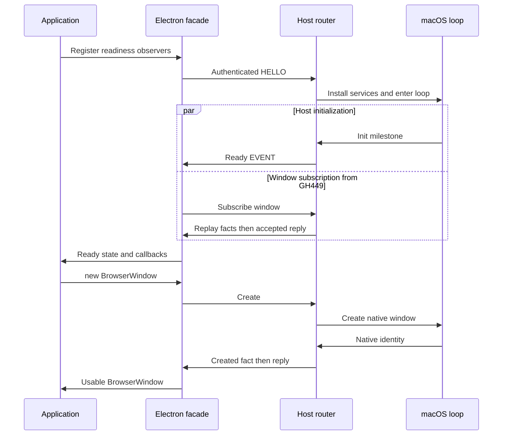

# Boot declaration and readiness design
Part of: [index](index.md)
Owns: Reuse decisions, schema declaration, host initialization, window availability and public readiness.

## 4. Design: first principles and startup

### First-principles and reuse decision

This is architecture under root AGENTS.md: it changes who owns the creation of
window #1, which sets crash ownership of the first window. It also changes when
recovery is armed for the new boot kind. The atoms separate observed source facts,
inferences and proposed tests. An unrun falsifier is a required check, not evidence
that the proposed runtime behavior has passed.

### Decision-bearing atoms

- **A1: Who declares the boot kind**
  - **Owner:** the boot compiler (`keld-cli boot.rs`) and parser (`app_session/boot_contract.rs`)
  - **Boundary and input/output:** `keld.config.ts` → `keld.boot.json` → `ParsedBoot`
  - **Failure mode:** the kind is inferred from absence, or the host guesses
  - **Observable:** AC-1–AC-3
  - **Evidence:** Schema 1 remains closed, requires `renderer`, and admits the
    existing optional `auth`; KEL-96 §4.2 requires a version decision. Schema 2
    was absent at historical approval base `3503a8aa`. Strict schema-2 parsing
    and `InitialWindow::None` already exist at the current Pin `ec29b7ce`; see
    [current source reconciliation](design-amendments.md#current-source-reconciliation-at-pin-ec29b7ce).

- **A2: Host initialized**
  - **Owner:** `keld-core` startup state machine and the keld-wv macOS loop
  - **Boundary and input/output:** `HELLO` + installed generation + `Init` turn → `Ready` trigger
  - **Failure mode:** `Ready` before the host can serve, before a startup failure, or on a pre-`Init` event
  - **Observable:** AC-5, AC-7
  - **Evidence:** FACT (tao 0.35.3): `NewEvents(StartCause::Init)` is issued from `applicationDidFinishLaunching:` (`platform_impl/macos/app_state.rs`);
    `open_urls` delivers `Event::Opened` through the same callback with no ready check; macOS `run_app` awaits `HELLO` before
    `WkWebViewEngine::new`

- **A3: Window module available, and no window call before Ready**
  - **Owner:** the GH-531 registry (F02-T2); today the UI wake bridge
  - **Boundary and input/output:** installed window-call servers → app `Create`
  - **Failure mode:** `Create` refused after `Ready`, or served before it
  - **Observable:** AC-14, AC-16, AC-18, GH-531 criterion 14
  - **Evidence:** FACT: `spawn_app_wake_bridge` runs before `run_return`; the g1 reader starts at install, before the loop; successor install replays `Ready`
    before it starts the reader. Therefore raw host Ready alone cannot prove successor Subscribe completed

- **A4: One `Ready` per generation and a usable facade-ready state**
  - **Owner:** primary router; facade composes the existing link and subscription
  - **Boundary and input/output:** trigger → Ready EVENT → accepted subscription/replay → public readiness
  - **Failure mode:** duplicate or lost Ready; constructor sees an untransferred registry
  - **Observable:** AC-4–AC-6, AC-8, AC-17–AC-18
  - **Evidence:** FACT: `signal_ready` writes again once recovery is armed; `ensureLink` is lazy; WorkerLink drops an EVENT with no listener. INFERENCE: later-task
    dispatch avoids losing coalesced HELLO/Ready. AC-17's coalesced and delayed-listener tests must prove that scheduling; an ordinary AC-4 run
    alone does not

- **A5: Failure and timeout**
  - **Owner:** KEL-96 §4.4 rules; keld-core coordinator
  - **Boundary and input/output:** pre-`Ready` failure → typed startup failure; post-`Ready` → runtime rules
  - **Failure mode:** hung boot, or misclassified failure
  - **Observable:** AC-7, AC-11, AC-14, AC-15
  - **Evidence:** FACT (tao 0.35.3): the waker starts only in `launched` (`app_state.rs:300-301`), and `wakeup` returns while `!HANDLER.is_ready()` (`:319-325`).
    So proxy commands (`Quit`, `Fatal`) and `WaitUntil` deadlines are inert before `Init`

- **A6: Renderer boots unchanged**
  - **Owner:** KEL-96, KEL-139
  - **Boundary and input/output:** schema 1 → today's path
  - **Failure mode:** a changed descriptor, trigger or replay
  - **Observable:** AC-2, AC-10
  - **Evidence:** FACT: named tests above; GH-531 criterion 15

- **A7: Recovered schema-2 generation**
  - **Owner:** host: this spec; eligible Create adoption: the GH-531 registry (#449)
  - **Boundary and input/output:** g1 loss → g2 `HELLO` → raw Ready replay → Subscribe/Created replay/accepted reply → public readiness → Create adopts
  - **Failure mode:** extra allocation for an eligible survivor; lost native identity
  - **Observable:** AC-8, AC-9, AC-19
  - **Evidence:** FACT: replay comes from the `window_ready` flag at successor install; GH-531 D-6 Option B retains every survivor, independent of adoption
    eligibility. The new document-state qualification is in §4.10

- **A8: Wire**
  - **Owner:** keld-ipc
  - **Boundary and input/output:** `LifecycleEvent::Ready` `0x00`
  - **Failure mode:** a new variant
  - **Observable:** none
  - **Evidence:** FACT: doc "The host is ready for the app process to create windows / run." (`crates/keld-ipc/src/lifecycle.rs:26`)

- **A9: Platforms**
  - **Owner:** keld-core parser per OS
  - **Boundary and input/output:** schema 2 on Windows/Linux → refusal
  - **Failure mode:** hollow backend method; silent fallback
  - **Observable:** AC-11
  - **Evidence:** FACT: KEL-96 §4.4 forbids a hollow `WebEngine` method; `KELD-CORE-034` is registered as "No-flag application boot is unavailable on this
    platform"

- **A10: Main-entry evaluation**
  - **Owner:** Bun entry loader and facade lifecycle adapter
  - **Boundary and input/output:** dependency/entry evaluation → later lifecycle delivery
  - **Failure mode:** early Ready while awaited setup or an imported module is still evaluating
  - **Observable:** AC-17, §4.12
  - **Evidence:** FACT: Electron v44.4.5 waits for its ESM entry load; Keld launches Bun directly and has no equivalent app-code-loaded signal. The pinned draw.io
    entry is native ESM. General awaited-entry equivalence is unproved

- **A11: Native failure custody**
  - **Owner:** keld-core main owner and keld-host fatal tail
  - **Boundary and input/output:** unresolved AppKit/profile owner → borrowed report → failed process exit
  - **Failure mode:** flattening/dropping an owner or deleting its live stage
  - **Observable:** AC-20
  - **Evidence:** FACT: current `HostRunFailure` retains a `!Send` macOS payload; `main` reports by borrow and skips dev-stage cleanup while custody is retained

Independence and the coupling they expose:

- **A2 ↔ A5 coupling.** Moving the trigger earlier also moves the recovery-arm point,
  because recovery is armed on the first successful `Ready` write (KEL-96 §4.4). This
  edge is explicit: D-3 and D-4 put every startup-fallible step before the trigger, so
  the arm point never precedes a startup failure.
- **A3 ↔ F02-T2.** This is an ownership edge, not shared state. The current Pin
  already constructs `WindowSession`/`WindowRegistry` in `finish_start` for facade
  boots. F02-T2 owns qualification of this existing pre-loop service and its rule-2
  test (AC-16), and implements only gaps proved by those tests.
- **A7 ↔ GH-531 D-6 and #449.** These are explicit cross-spec edges. D-6 owns host crash
  ownership of windows for every boot kind. The pinned registry's `Create` adoption
  owns the no-second-window rule, keyed on registry state. #449 qualifies that path.

Reuse:

- **Wire.** Kept: lifecycle channel 3 and its replay rule. No new message.
- **Router.** Kept: `PrimaryRouterHandle::signal_ready` and its arm protocol. Only
  the event that calls it changes per boot kind.
- **Replay.** Kept: the `window_ready` replay at successor install. It already means
  "the initial `Ready` was written".
- **macOS UI loop.** One private owner, parameterized by its startup milestone. No
  copied closure.
- **Deadline.** One constant, `INITIAL_NAVIGATION_DEADLINE`, renamed
  `INITIAL_MILESTONE_DEADLINE` in T-1 with the same value.
- **Window observation.** Keep `NativeWindowObserver` for its positive, title-scoped
  presentation/identity checks. Add the independent process-wide application-window
  absence oracle in AC-4; do not reinterpret an empty title match as zero windows.
- **Error codes.** Reused: `KELD-CORE-034` (platform), `035` (descriptor), `037`
  (session startup), `040` (registry not ready, GH-531) and `KELD-CLI-047` (staging).
  One new code, `KELD-CORE-044`, takes the next number after GH-531's reserved
  038–043, so F02-T2 cannot collide with it.

No rewrite. Compatibility fallback: `not required`. Schema 1 stays valid and is still
emitted for renderer boots, so no published descriptor changes meaning.

### D-1: How a facade boot is declared

**Decision.** `keld.boot.json` schema 2 is a closed document:

```json
{
  "schema": 2,
  "name": "Example",
  "entry": "src/main.ts",
  "permissions": {
    "file": "keld.permissions.jsonc",
    "content_sha256": "sha256:0123456789abcdef0123456789abcdef0123456789abcdef0123456789abcdef"
  }
}
```

- `schema: 2` is the declaration: the host creates no initial window, and the app
  creates every window.
- `renderer` is not a schema-2 field.
- All other rules are schema 1's: 64 KiB, UTF-8, duplicate keys, `name`, the relative
  `entry`, `permissions`.

The parser dispatches on `schema` with a typed probe (`struct SchemaProbe { schema: u8 }`),
then parses the version's own `deny_unknown_fields` struct. It never goes through
`serde_json::Value`, whose map keeps the last duplicate key. The schema-1 struct and
its checks, including optional `auth`, are unchanged. Both yield one `ParsedBoot`, whose internal
`initial: InitialWindow` is `Renderer(PathBuf)` for schema 1 and `None` for schema 2.
The common parsed result retains all other current fields and validation rules;
schema 2 supplies no authentication-provider declaration and does not silently add
an `auth` or profile field to its four-field closed shape.

The project declares it with `initialWindow: "none"` in `keld.config.ts`. One keld-core
resolver beside `renderer_from_config_ts` reads it (`crates/keld-core/src/hello.rs:124`).
The boot compiler, `keld doctor`'s renderer check and `load_dev_window_html` all
consume that resolver instead of each defaulting `renderer` on its own. `keld migrate`
will write this field (out of scope). A later `compat: { electron: true }` must not
imply it separately: one fact, one key.

**Rejected:**

- *Optional `renderer` in schema 1, where absence means facade.* Absence would carry
  meaning: a dropped line silently changes window and crash ownership, and it changes
  schema 1's meaning without a version decision (KEL-96 §4.2).
- *A new field added to schema 1.* Same objection: v1 is closed by approval.
- *A single-valued `initial_window: "none"` field in schema 2.* `schema: 2` already
  says it. A one-value field is redundant, and it is a second place to keep in sync.
- *Schema 2 for every boot, with a v1 fallback.* This changes every renderer-boot
  descriptor and fixture (A6) and adds a second accepted renderer shape with no
  shipped v1 artifact to protect.
- *A schema-2 form that carries `renderer`.* It would be accepted but never emitted:
  dead surface (YAGNI). A later version can add it.
- *The host inspects `entry` for `@keld/electron`.* The host never evaluates app
  source (KEL-96 D-3).
- *An environment variable or CLI flag.* This is the no-flag boot. A flag would be a
  second declaration channel (KEL-96 D-3/D-9).

**Falsifier.** A document that the parser accepts but cannot classify. Or a schema-2
document with `renderer` that parses. Or a schema-1 `ParsedBoot` that changes. AC-1 and
AC-2 cover all three.

### D-2: Renderer-declared boots keep CreateInitialWindow before Ready

**Decision.** Yes, decision (b) is "keep". Schema-1 boots keep KEL-96 §4.4 steps 7–8
verbatim: `NavigationReady` triggers `Ready`, the descriptor bytes are unchanged, and
the run path is unchanged.

The GH-531 "legacy teardown arm" is therefore the permanent schema-1 close path, not a
temporary adapter. Its owner is KEL-96, whose §4.5 defines schema-1 close and
`LastWindowClosed`. It is removed only by an approved spec that registers the schema-1
initial window in the GH-531 registry or retires schema 1 (GH-531 §4.c, amended by #657).

**Rejected:** *Move `Ready` for every boot.* It would change:

- KEL-96 AC-11 for shipped renderer boots;
- the KEL-139 product fixture, which reads `READY` and then expects exactly one native window (`crates/keld-host/tests/no_flag/macos/support/product.rs:217-256`);
- the Linux and Windows beacon-then-`READY` cycles;
- the recovery-arm point for a host window that is still navigating, which opens a pre-navigation recovery the KEL-139 AC-5 continuity oracle does not cover.

The issue's INFERENCE that fixtures would need a window-specific event is confirmed by
`product.rs`.

**Falsifier.** Any AC-10 test changes, or a schema-1 `Ready` is written before
`NavigationReady`.

### D-3: What "host initialized" means

**Decision.** In a schema-2 boot, the host is initialized when all of these hold:

1. KEL-96 steps 1–6 succeeded, with `ResolveTargets` validating `entry` only.
2. The authenticated generation is installed in the router, and the router is attached.
3. Every window-call server is installed (D-4).
4. The macOS UI loop has delivered the `Event::NewEvents(StartCause::Init)` turn on the
   UI thread. tao 0.35.3 issues that turn from `applicationDidFinishLaunching:`.

The backend emits `AppWindowEvent::HostInitialized` exactly once, from the `Init` match
arm only, never from "the first closure call". The reason is that tao's `open_urls`
delivers `Event::Opened` through the same callback with no ready check
(`app_state.rs:309`). So a launch URL can reach the closure before `Init`. The
coordinator maps `HostInitialized` to `signal_ready`.

**Launch URLs.** keld-wv's macOS loop has no arm for `Event::Opened` today, so a
launch URL delivered before or after `Init` is dropped. Their owner is #524 (F01-T8):
`open-url`/`open-file` delivery, with a pre-ready queue after `will-finish-launching`.
Until #524 lands, they are a recorded unknown. This spec only guarantees that `Opened`
never triggers `Ready` (AC-7).

Electron v44.4.5 supplies the comparison baseline, pinned in §4.12. Its native
`Browser::DidFinishLaunching` sets readiness and resolves the readiness promise before
notifying the ready observers; its loader also waits for entry-module evaluation.
This verifies a window-independent initialization boundary, but does not prove that
tao's single `Init` event satisfies every Electron initialization obligation. Keld's
complete prerequisite set is the four conditions above, the qualified entry-order
tests in AC-17, and the facade subscription boundary in AC-18.

**Rejected:**

- *`Ready` on `HELLO` acceptance (the literal issue wording).* Engine and loop creation
  would then run after `Ready`. Their failures would become post-`Ready` runtime
  failures, and recovery would be armed while the host cannot serve a window. That
  breaks KEL-96 §4.4's rule that a failure before `Ready` is a startup failure (AC-5's NC).
- *`Ready` on the first closure call.* A pre-`Init` `Opened` would trigger it (AC-7's NC).
- *`Ready` after the first app-created window navigates.* Deadlock: an Electron app
  creates windows only after `ready` (`browser-window.md`: "cannot be used until the
  `ready` event").
- *KEL-75's role `Ready(g)` acknowledgement.* KEL-75's `Ready(g)` is a role-to-host
  receipt. This spec's `Ready` is the KEL-72 host-to-app event. Conflating them changes
  direction and wire. KEL-75's meaning is untouched, and this spec infers nothing about it.

**Falsifier.** The role reads `Ready` while a startup-fallible host step is still
ahead (AC-5, AC-14), or on a pre-`Init` event (AC-7).

### D-4: What "window module available" means

**Decision.**

1. **Install before the loop.** Every host component that serves the app's window calls
   is installed before the schema-2 loop is entered.
2. **No window call before Ready.** Lifecycle `Subscribe` remains legal before Ready.
   The host first rejects a window call from an unsubscribed link with
   `KELD-CORE-045`; a subscribed call admitted before the first `Ready` transition gets
   `KELD-CORE-040` (registry not ready) and creates nothing.
   - The not-ready state ends immediately before the first `Ready` is written, inside
     the same router transition and under the shutdown transition guard, as the
     recovery-arm enqueue does today. So any window call the role sends after it
     observes `Ready`, including one in the task in which `whenReady()` resolves, is
     served. If that `Ready` write then fails, the startup failure (rule 3) ends the
     session.
   - A successor generation cannot reach a window call before its `Ready` replay,
     because install replays `Ready` before it starts the reader. This also means a
     successor cannot treat raw Ready as proof that its Subscribe completed (D-5).
   - The rule is the host's, keyed on the registry's state. The facade's own
     Electron-style refusal ("Cannot create BrowserWindow before app is ready") is not
     the guarantee, because a role can send the frame directly.
3. **A failed install is a startup failure.** It writes no `Ready`, calls
   `deny_recovery`, runs the KEL-96 steps 5–8 cleanup, and ends with `KELD-CORE-037`.
   The coordinator treats a closed event channel before `HostInitialized` as that
   failure, never as success. Today, `while let Ok(event) = events.recv()` ends quietly
   in `coordinate_window_events`; schema 2 must not inherit that.

All existing authority, filesystem and authentication service prerequisites stay
before the earlier Ready boundary. A newly true readiness boolean cannot bypass
permission checks or generation retirement/quiescence.

At current Pin `ec29b7ce`, the window-call path is already present in source.
The primary reader dispatches the `window` channel to `window_router`; facade boots
construct a `WindowSession` that owns a `WindowRegistry`; and `Subscribe` replays
window facts before its accepted reply. The host checks subscription (`KELD-CORE-045`)
before registry readiness (`KELD-CORE-040`) and before decoding a window request.
The Host-backed `BrowserWindow` sends `WindowRequest::Create`, while the existing
`LifecycleLink` publishes public Ready only after raw Host Ready and accepted
Subscribe/replay. These are source-presence facts, not acceptance receipts.

F02-T2 owns qualification of the existing GH-531 registry rule-2 path and any proven repair;
do not assign any remaining registry gap to GH-446 T-1, add a parallel registry, or
describe the window CALL as absent. F02-T2 is tracked by #449; that issue remains the
acceptance record for subscription/replay, constructor identity, eligible-survivor
adoption and first-window/native behavior. AC-4's zero-window claim is proved only by
its process-wide observation at the stated boundary, not inferred from an absent
window-call path.

**Rejected:**

- *Facade discipline only.* A role that bypasses the facade could create a window
  before `Ready`, so census 0 would not be a host fact.
- *A separate registry-ready handshake before `Ready`.* The registry already
  exists before the UI loop and has an internal `ready` state. `signal_ready` marks
  it serviceable under the shutdown transition guard immediately before writing
  `Ready`; a second wire handshake would duplicate that guarded transition and add
  a protocol edge without improving admission.
- *A second lifecycle event, "window module ready".* That is a wire change, and
  Electron has one `ready`.

**Falsifiers and NCs:**

- A `Create` before the first `Ready` write that does not get `KELD-CORE-040` (AC-16).
  NC: marking the registry ready at construction serves it.
- A failed install that writes `Ready` (AC-14). NC: signalling before the install result
  writes it.
- GH-531 criterion 14's NC: keep the registry unready through the first post-Ready
  `Create`; it is incorrectly refused with `KELD-CORE-040`.

### D-5: Host Ready, entry evaluation and usable facade readiness

**Decision.** These are ordered prerequisites, not a claim that main evaluation
finishes before HELLO. Generation 1 of a schema-2 boot follows this partial order:

1. Bun starts evaluating the main module and its imports. A lifecycle call in an
   imported module can open the lazy link before the main entry body executes.
   `app.isReady()` alone does not open it on current main.
2. The existing WorkerLink authenticates `HELLO`; only the admitted generation is
   installed. This is link readiness, not host Ready.
3. The engine, authority services and window-call servers are installed and the UI
   loop is entered. The genuine `Init` turn emits `HostInitialized`.
4. In one guarded transition the existing registry becomes serviceable, the host
   writes its one Ready EVENT, and successful writing arms the existing recovery
   protocol. No startup-fallible service installation remains after that boundary.
5. The existing transport delivers the event after the lifecycle listener is
   installed. AC-17 must exercise coalesced HELLO/Ready, delayed attachment and an
   imported module's early lifecycle call; the ordinary path is not sufficient proof.
6. At the current Pin, the facade composes raw host Ready with accepted window subscription
   and complete replay. The host writes all replayed `Created` facts before the
   correlated accepted `Subscribed` reply on the same ordered stream. Processing
   that reply after applying the facts is the completion boundary, including an empty
   replay. A repeated Subscribe is idempotent and cannot replay or re-arm adoption.
7. Only after both prerequisites hold does the facade set its public ready state,
   emit `ready` once and resolve its readiness waiters. `isReady()`, `whenReady()` and
   `ready` use that same state. A constructor called in either callback is usable.
   No total order between the event listener and promise continuations is required.

Subscription can complete before or after raw Ready. In g≥2 the existing installer
replays Ready before starting the successor reader, so the raw event can necessarily
precede processing that generation's Subscribe. The facade barrier is therefore
required for both zero-survivor and recovered-window cases; it is not a second host
lifecycle event, socket or reader.

**Entry qualification.** Synchronous CJS entry and synchronous native-ESM dependency
graphs require callbacks after graph evaluation and listener registration (AC-17).
Electron v44.4.5 additionally waits for awaited ESM initialization. Keld's direct Bun
launch has no app-code-loaded receipt; later-task dispatch alone does not prove that
broader property. Qualify the pinned draw.io graph and its admitted dependency closure
before claiming MVP compatibility. Any awaited setup found in that closure blocks
that claim until an explicit loader-boundary design and failing test are approved.
Do not add a universal completion wait to shared `@keld/api`: native entries can
legitimately await its filesystem/auth APIs, which themselves await raw host Ready.
Withholding that Ready until the entry finishes would deadlock those existing apps.

The following is the **target framework sequence**, not evidence that current main
already implements schema 2 or BrowserWindow. The parallel branches make the
permitted subscription/Ready order explicit; main evaluation is covered separately
by AC-17.



Once-ness has one startup-trigger owner, the coordinator. Each boot kind has one
`ReadyTrigger`. A foreign or repeated trigger is `KELD-CORE-044`, then the existing
fatal path. Successor Ready remains the existing guarded install replay, with fresh
authority and retired-generation filesystem quiescence, not a second UI `Init`.

**Rejected:** relying only on backend discipline (app-created navigation must not
re-trigger startup); making `signal_ready` silently idempotent (hides an invariant
fault); publishing public readiness when Subscribe is merely sent; gating shared
native API readiness on main completion.

**Falsifiers.** An application-lifecycle EVENT precedes initial Ready; an allowed
control reply does not falsify the order. Ready is lost under coalescing, or a public
callback runs before the qualified entry graph has finished (AC-17). Any public
readiness observable escapes the subscription barrier (AC-18). A wrong or repeated
startup trigger writes another Ready (AC-6).
